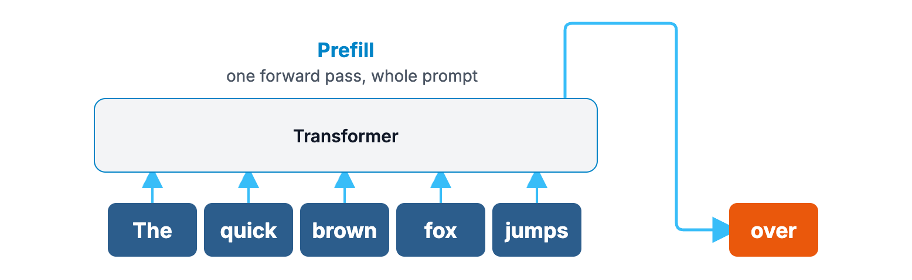
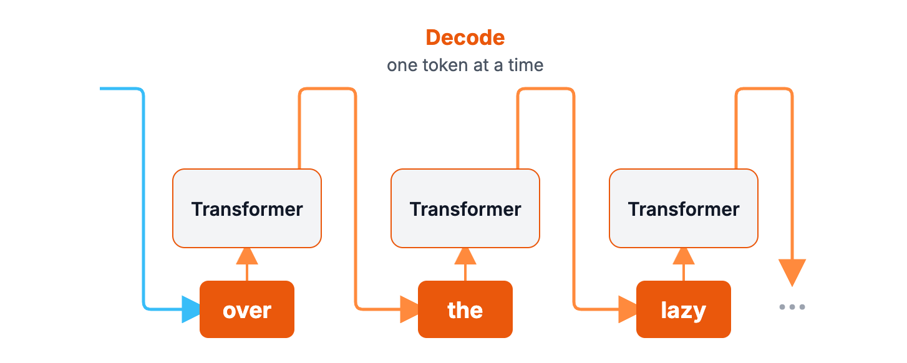
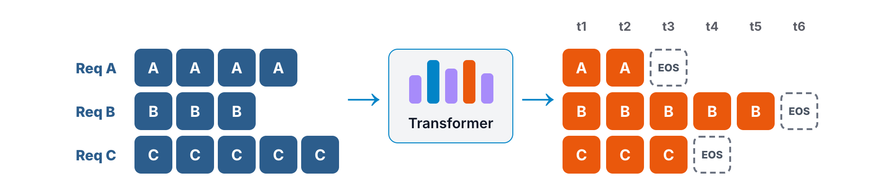
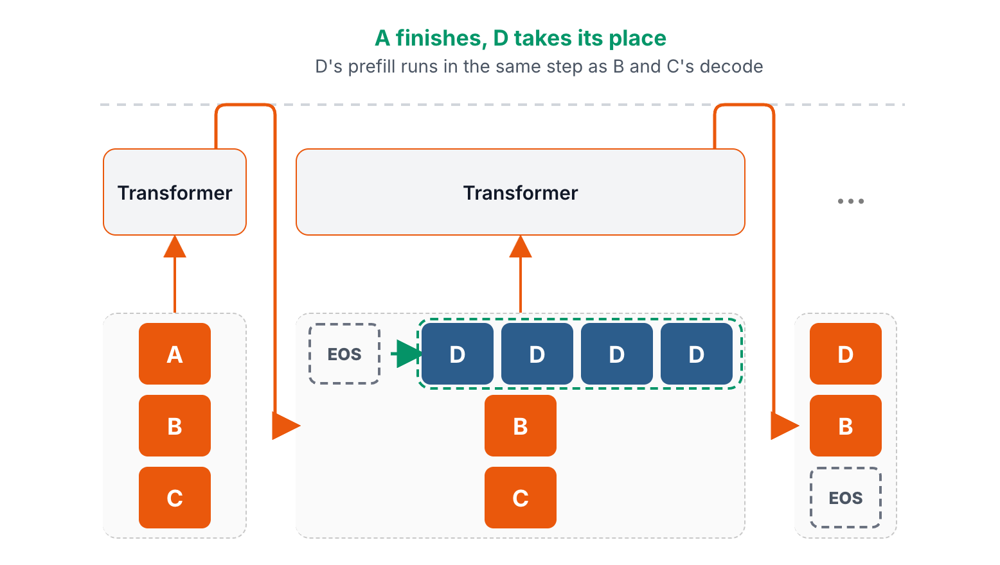
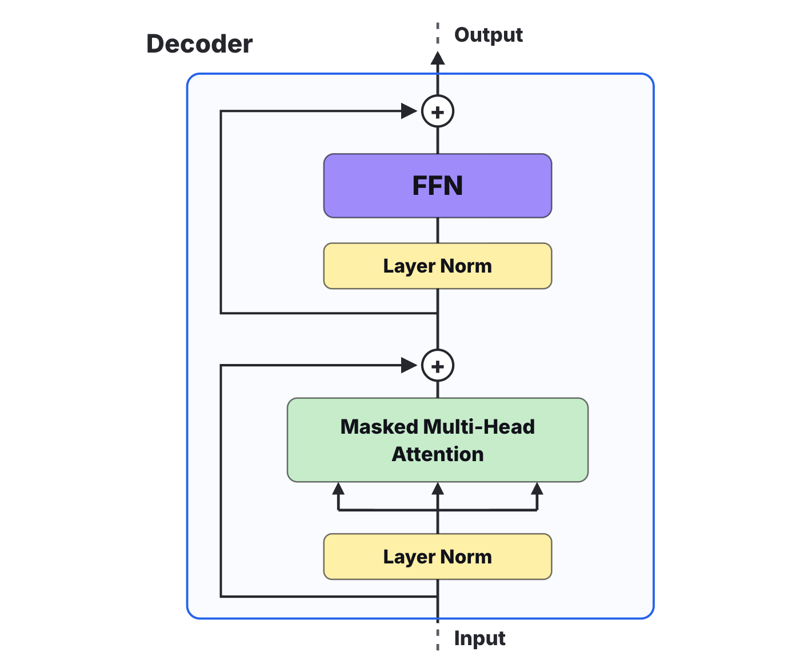
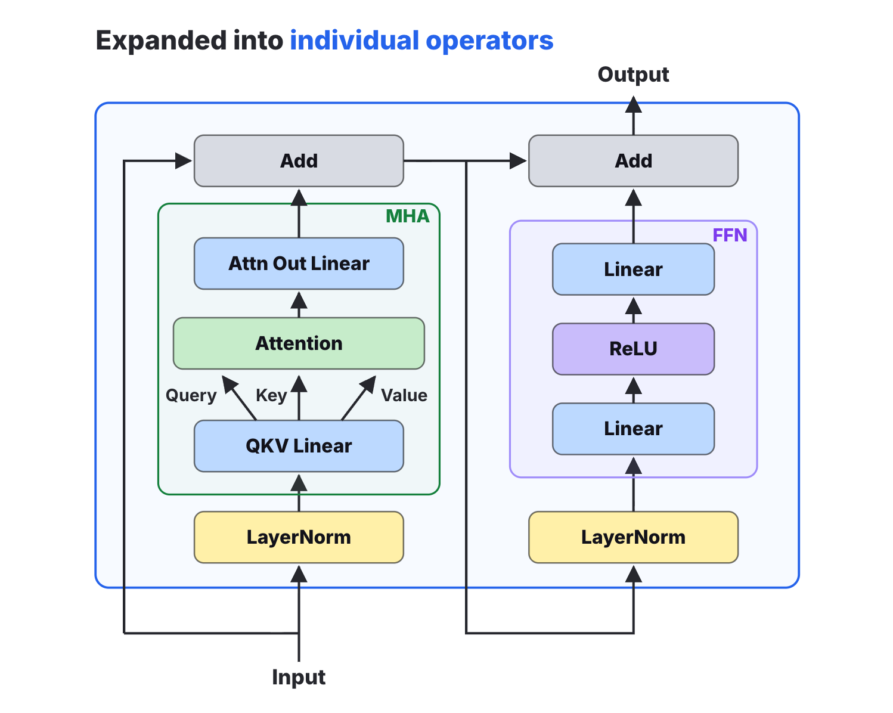
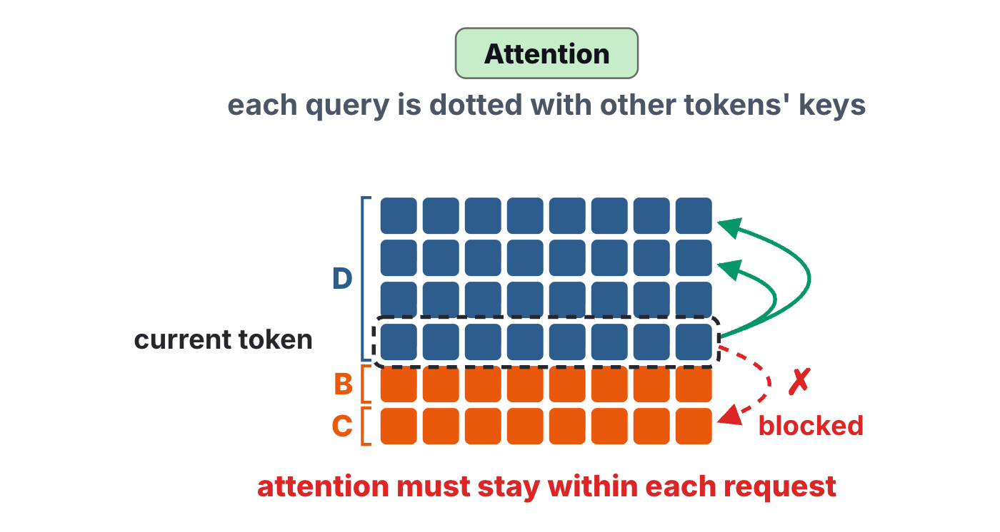
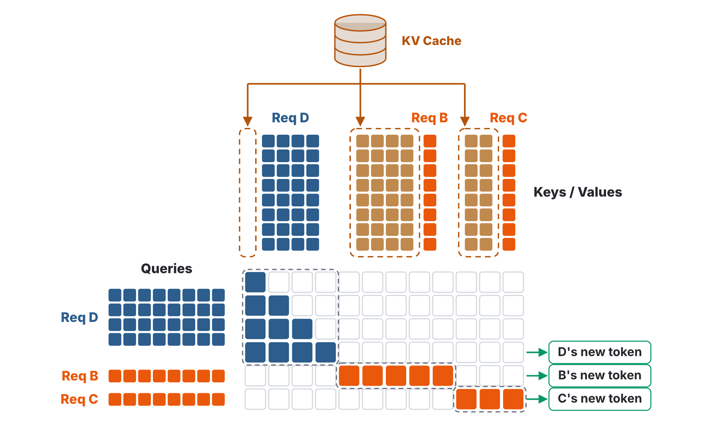
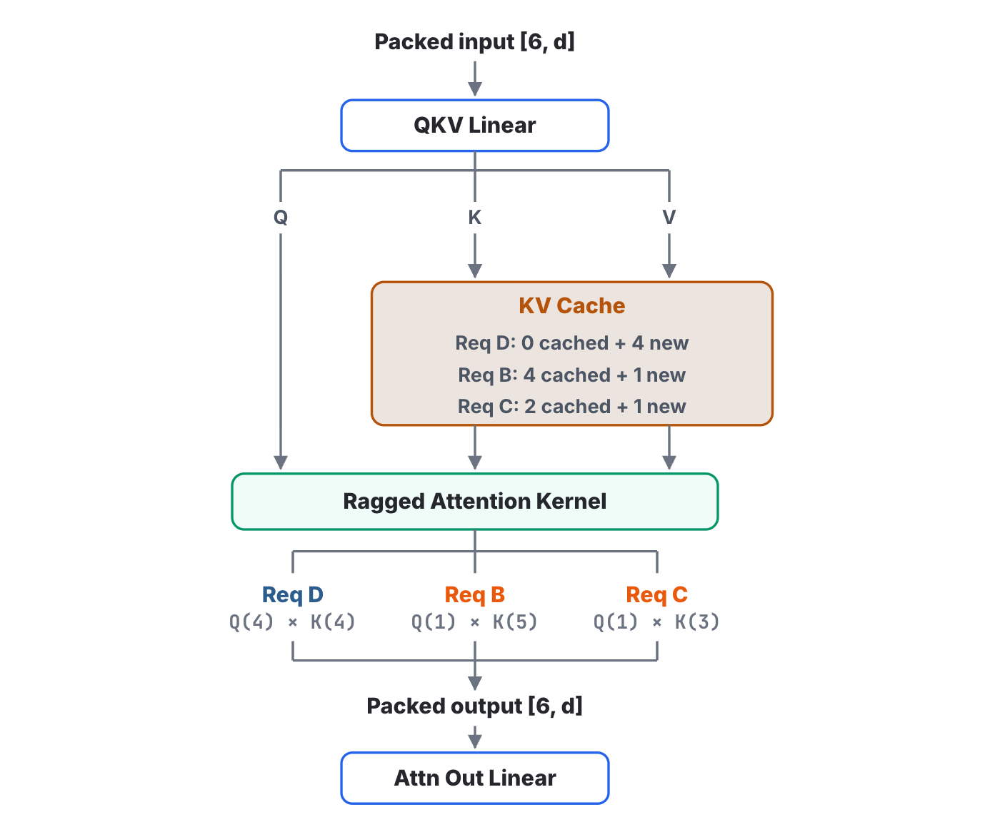
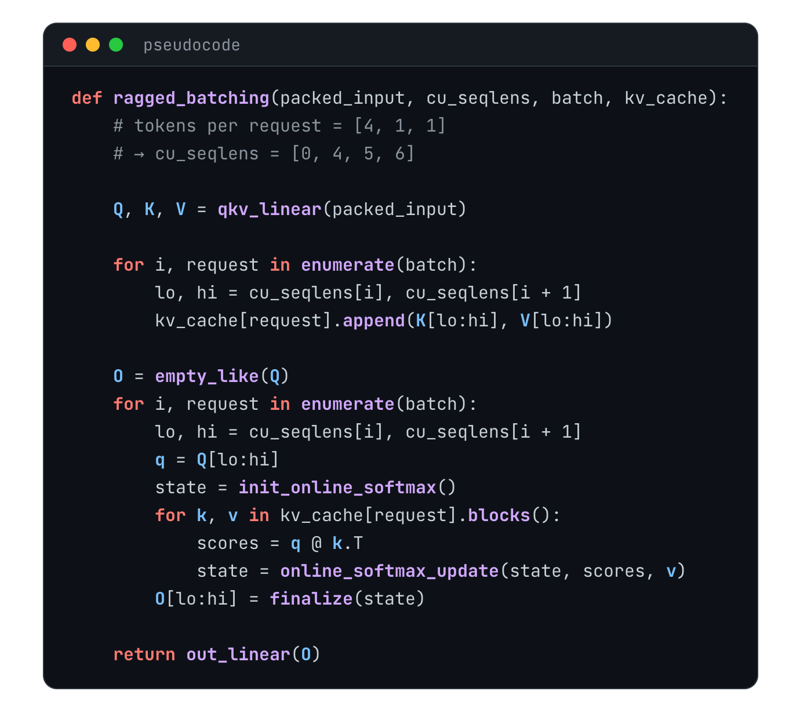

When an LLM runs inference on one request at a time, most of the GPU's compute sits idle. Think of a road at rush hour: every car could carry at least four people, but each one has only the driver, so most of the road's capacity goes to waste. That's what happens on the GPU, and it's the reason inference engines batch requests. Batching sends several inputs through the model together, which keeps the Tensor Cores busy and raises the model's throughput dramatically. Frameworks like vLLM and SGLang go a step further with a technique called continuous batching. This post walks through how it works.

## Naive batching: the whole batch finishes together

I've covered how a Transformer runs inference in [earlier posts](/posts/kv-cache-vs-prompt-cache/), so here's a quick recap. Generating a response happens in two phases. The first is prefill: the model reads your entire prompt in a single pass to get ready to answer.

The second is decode. The model starts writing its answer, and each forward pass produces exactly one token. That token is appended to the input and used to compute the next one. Generating text this way is called autoregressive generation. To keep things simple, this description covers a single request.

So what does the most naive form of batching look like? Say requests A, B and C arrive at the same time. The simplest approach is to pad all three to the length of the longest one, send them through the Transformer as three tensors of the same length, and produce the next token for all three requests on every forward pass. When one request emits EOS, the end-of-sequence token, the batch still isn't done. All three requests keep computing until every one of them has finished, and only then is the batch complete.

Put simply, a naive batch starts together and finishes together, and nothing is released until the longest request is done. Imagine one request with a very long answer. The slots of the requests that already finished burn compute for nothing, new requests can only wait, and the GPU's capacity is wasted.

## Continuous batching: a new request joins as soon as one finishes

Can we do better? That's what continuous batching is for. Take the same example. As soon as we see that request A has emitted EOS, we stop keeping A in the batch and let a waiting request, D, take its place. Say D's prompt is 4 tokens long. The next input sent through the Transformer is then D's 4 tokens plus 1 token from B and 1 token from C. One step later, C finishes as well, and the next waiting request takes C's place in the same way.

The scheduling decision has moved. Instead of waiting for the whole batch to finish, it happens at every forward step: as soon as one request finishes, a waiting one fills its slot. The GPU never idles, and new requests don't have to wait for the batch to drain.

## Packing the inputs: pad into a block, or flatten

The idea is easy to follow, but making it work raises plenty of practical questions. As we just saw, a single batch can contain both prefill and decode requests. How is the Transformer supposed to handle that? Let's take it one step at a time.

The first question is how to combine these requests' inputs. Say the embedding dimension is d. Request D is in prefill, so its input is a [4, d] matrix. Requests B and C are both decoding, so each of their inputs is a [1, d] matrix. There are two ways to combine them. The first is to add a dimension, turning each 2D input into a 3D one, so [4, d] becomes [1, 4, d]. Since the three inputs aren't the same length, the two [1, d] matrices have to be padded with blank tokens up to [4, d], and the combined input becomes a [3, 4, d] tensor. Now imagine a new request with a very long prompt joins the batch. Every decode request would have to be padded to that same length, which is a huge waste of compute. Padding is not the way to go.

![Option 1: pad B and C with blank tokens to D's length and stack all three into a [3, 4, d] tensor](t3_padded.png)

The second way is to skip the extra dimension and join the three matrices end to end into one flat [6, d] matrix. There's no padding at all, but it creates new problems further along in the computation, and those need solving too.

![Option 2: concatenate the three inputs into one [6, d] matrix](t3_packed.png)

## One layer: which operators care how the input is packed

Let's look at what a Transformer decoder computes. Here's the structure of one decoder layer. The input first goes through a layer norm and into masked multi-head attention. The result is added back to the input as a residual, goes through another layer norm into the FFN, the feed-forward network, and gets one more residual add. That's the layer's output.

Going one level deeper, multi-head attention projects its input into the Q, K and V matrices with a linear layer, computes attention, and passes the result through one more linear layer, the output projection. The FFN is simpler: a linear layer that projects up to a wider dimension, an activation function, and a linear layer that projects back down.

With the operators laid out, a pattern stands out. Layer norm, the QKV projection, the whole FFN, in fact everything except attention, works on each token independently. Each operation turns one row vector into another row vector, with no reference to the tokens above or below it. That property is perfect for an input made of several requests joined together. These operators don't care which request a token belongs to, because every token goes through the same transformation.

![LayerNorm, QKV Linear and FFN treat each row on its own, so the whole packed [6, d] input goes through them in one pass](t4_per_token.png)

Attention is a different story. At its core, each token's query vector is dotted with other tokens' key vectors, and that's where the packed input breaks down. Take a token from request D. Dotting it with the tokens before it in D is fine. Dotting it with the tokens after it is not, because those belong to B and C, a different request entirely, and a token from D has no business looking at another request's tokens. So every computation in the Transformer is indifferent to how the input is packed, except attention. Attention can't be applied directly: it has to know which tokens in the packed input belong to which request.

## Ragged batching: attention in per-request blocks

So how does attention change to handle a packed input? The technique is called ragged batching. This figure shows the attention score matrix it computes.

Start with the queries. They come from projecting this step's input, so just as the input has 6 rows, the query matrix has 6 rows too. The keys and values they're dotted with are a different matter. Request D is in prefill, so its keys and values are also projected from the input and cover the same 4 tokens. Dotting them pairwise gives a 4×4 lower-triangular score matrix. Request B is decoding, so its one query has to be dotted with every token it has seen so far. Where are those earlier tokens? They're stored in the KV cache. Read them out, add the current token, and B's keys and values cover 5 tokens, so B's scores form a 1×5 matrix. Request C works the same way. After softmax, each row of scores weights the value vectors, giving one output vector per query, and the last row of each request is the one that produces that request's next token.

When a query and a key belong to different requests, the pair is masked out and gets zero weight. Most of the matrix is masked this way, and in practice those pairs aren't computed at all. They're drawn here only to make it clear which values actually get computed. The upshot of ragged batching is that the attention matrix no longer has as many columns as rows. The queries are this step's new tokens joined together, the keys are each request's cached history plus its new tokens, and Q and K don't need to be the same length at all.

## Inside the kernel: cu_seqlens splits six rows back into three

With the idea clear, let's look at how ragged batching is implemented. The diagram shows the operator's data flow. The packed input first goes through the QKV projection to get the query, key and value matrices. The keys and values are then written into the KV cache, each into its own request's entry. New request D starts with an empty cache and adds 4 new tokens; request B adds 1 new token to the 4 it already has. Once the cache is written, all the keys and values are read back and sent, along with the queries, into the ragged attention kernel, which splits the work by request and computes it in parallel. D's scores are 4 queries against 4 keys, B's are 1 query against 5 keys, and C's are 1 query against 3. The outputs are joined back into a matrix with the same 6 rows.

The pseudocode uses a special array called `cu_seqlens`. It's a boundary table that records the row where each request starts and ends in the packed input. With 3 requests of [4, 1, 1] tokens, `cu_seqlens` is [0, 4, 5, 6], meaning request 0 covers tokens 0 through 4 − 1, and so on. With `cu_seqlens`, it's easy to reach any single request inside the large packed matrix. Real kernels take exactly this kind of table: FlashAttention's `flash_attn_varlen_func` takes it as `cu_seqlens_q` and `cu_seqlens_k`, and PyTorch's `varlen_attn` calls them `cu_seq_q` and `cu_seq_k`.

First, we project the input once to get Q, K and V. Then, for every request in the batch, we use its slice of the new keys and values to update that request's KV cache. With that done, attention can begin. For each request, `cu_seqlens` tells us which rows of Q are its own, and we read that request's own part of the KV cache. The cache is stored in pages of physical blocks, so it's read one block at a time. For each block, we dot this request's queries with the block's keys to get attention scores, use the scores to weight the block's values, and accumulate the result into a running state. This is online softmax, which I covered in full in [the FlashAttention post](/posts/flash-attention/); if it's unfamiliar, the complete online softmax code is there. When every request is done, the output matrix has all 6 rows again, and one last output projection finishes attention for this layer.

(The function names in the pseudocode are made up for teaching, apart from `cu_seqlens`. A real implementation is a single kernel launch, and the two Python loops become CUDA blocks running in parallel.)

## Summary: what it saves is compute spent on empty slots

Back to the question we started with. Sending several requests through one forward pass does put idle compute to work, but forming a batch isn't enough on its own: once the roster is fixed, the requests that finish first leave their slots burning compute. Continuous batching comes down to three steps. First, scheduling moves from the end of the batch to every forward step: whoever finishes leaves, and whoever is waiting joins. Second, the mixed inputs aren't padded but flattened into one long sequence, so every per-token operator runs over it in one pass, unchanged. Third, attention, the one operator that can't be applied directly, is computed per request, with each request reading only its own part of the KV cache. What continuous batching really saves isn't any one user's waiting time. It's the compute the GPU would otherwise spend, every step, on empty slots.

## References

1. Rémi Ouazan Reboul et al. [“Continuous batching from first principles.”](https://huggingface.co/blog/continuous_batching) Hugging Face Blog, 2025.
2. PyTorch (@PyTorch). [“torch.nn.attention.varlen.”](https://docs.pytorch.org/docs/main/nn.attention.varlen.html) PyTorch documentation.
