The FlashAttention paper has a striking benchmark. Training GPT-2 small on eight A100s took 9.5 days with the Hugging Face implementation and 4.7 days with NVIDIA's Megatron-LM. With FlashAttention it took 2.7 days, and the trained model was exactly as good: all three reached the same perplexity of 18.2. In another benchmark, reads and writes to GPU memory dropped from 40.3 GB to 4.4 GB, about 9× less. (These are the paper's 2022 comparisons. Both baselines have since adopted fused attention kernels, so the gap would be smaller today.)

FlashAttention-style kernels are now a standard part of the modern LLM stack. PyTorch 2, Hugging Face and vLLM all ship them as attention backends. So how does it pull this off? This post builds it up one step at a time.

## GPU memory comes in tiers

Start with the fact that GPU memory is layered. At the top is SRAM, which sits on each streaming multiprocessor (SM), the GPU's compute units. On an A100 its bandwidth is about 19 TB/s, but all the SRAM across the whole chip adds up to only about 20 MB. In the middle is HBM, high-bandwidth memory, the kind SK hynix and Micron make. An A100 has 40 GB of it, at 1.5 TB/s. At the bottom is the CPU's DRAM, which can reach terabytes but delivers only 12.8 GB/s, in a different league entirely from the two above.

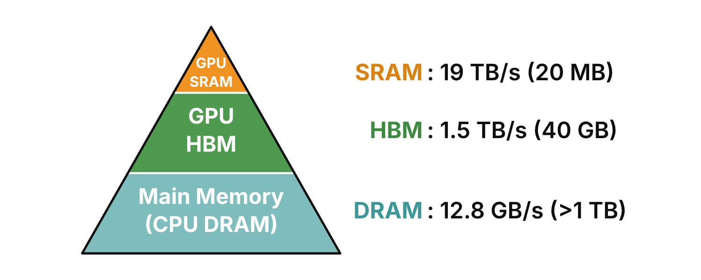

Think of HBM as the warehouse. Model weights, the KV cache and every layer's activations all live there. SRAM is the workbench: it holds only the small piece of data being worked on right now and is freed as soon as that work is done. The compute units can't operate on numbers in HBM directly. Any number that takes part in a computation has to be copied from HBM into on-chip SRAM first. So the way to make a GPU fast is to finish as much work as possible in SRAM and avoid reading and writing HBM in the middle of a computation.

## Attention: the matrices don't fit, the vectors do

With that in mind, look at how much data attention handles. I covered the formula in my [post on the KV cache](/posts/kv-cache-vs-prompt-cache/), so here's the short version. Say the prompt has n tokens, and each token's Q, K and V vectors have d dimensions. Then Q, K and V are each an \(n \times d\) matrix. Attention multiplies Q by K transposed, divides by the square root of d, applies softmax to each row to get an \(n \times n\) table, and finally multiplies by V to get the output O, another \(n \times d\) matrix.

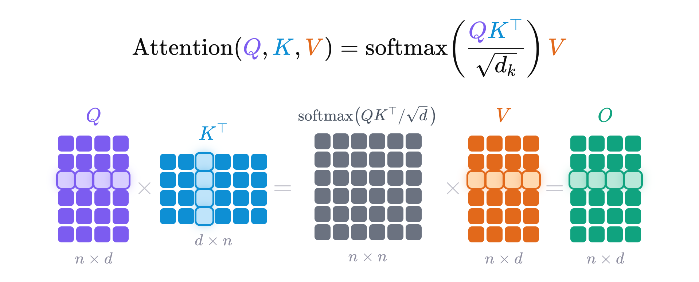

The key point is that n is the context length, which can reach a hundred thousand tokens or even a million, while d is the dimension of one head, a constant like 32, 64 or 128 in most models. Both the \(n \times d\) matrices and the \(n \times n\) table are far bigger than SRAM, so they can only live in HBM. (At n = 128K and d = 128 in FP16, a single \(n \times d\) matrix is 32 MB and the \(n \times n\) table is 32 GB.) Only data that doesn't grow with n, like a single token's q, k, v and o vectors, fits into SRAM in one go. This is the most fundamental constraint on running a Transformer on a GPU.

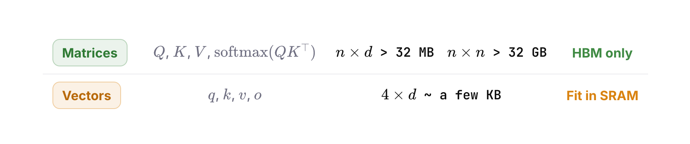

## Three steps, and every row is independent

So where exactly does attention lose time? Let's break the computation down as far as it goes and follow the first row through each step.

Step one is S = QK transposed. The first row is q1 dotted with k1, k2, all the way to kN: n numbers that are the first token's attention scores against every token. At this point they're raw scores, not yet normalized. (The diagrams leave out the division by the square root of d to keep them clean. It doesn't change anything here.)

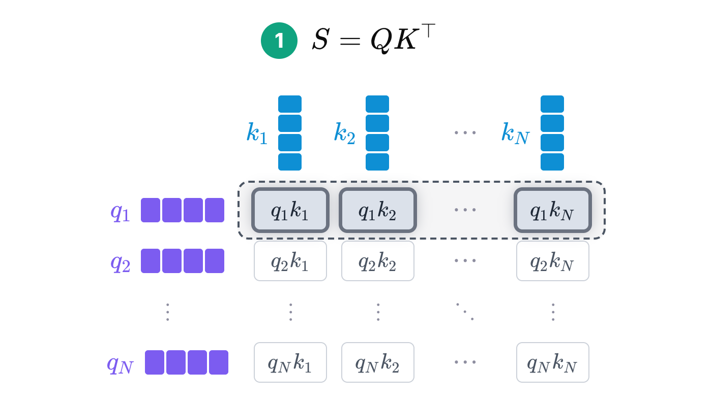

Step two is P = softmax(S), applied row by row. Softmax turns a row of raw scores into a probability distribution that sums to 1: take the exponential of each score and divide by the sum of the exponentials across the row. So p11, p12, through p1N add up to exactly 1.

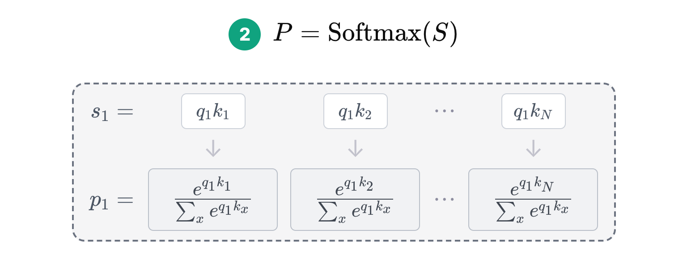

Step three is O = PV. For the first token, p1 times V expands to v1 times p11, plus v2 times p12, all the way to vN times p1N. In other words, every token's value vector is weighted by those attention probabilities and summed into one output vector, o1.

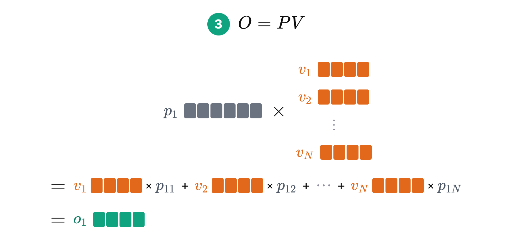

Remember that nothing whose size depends on n fits in SRAM. So in step one, we can only bring in one q and one k from HBM at a time, compute their dot product, and write the result straight back to HBM, because SRAM has no room for a whole row of n results. Steps two and three work the same way: each one reads the previous step's results from HBM, computes, and writes its own results back to HBM.

## Kernel fusion: three round trips into one

The left half of this diagram shows the standard attention computation on a GPU. Each step reads part of the data from HBM, computes, and writes the result back to HBM, and this happens three times. Since HBM is so much slower than SRAM, a large share of the time goes into writing intermediate results to HBM and reading them back.

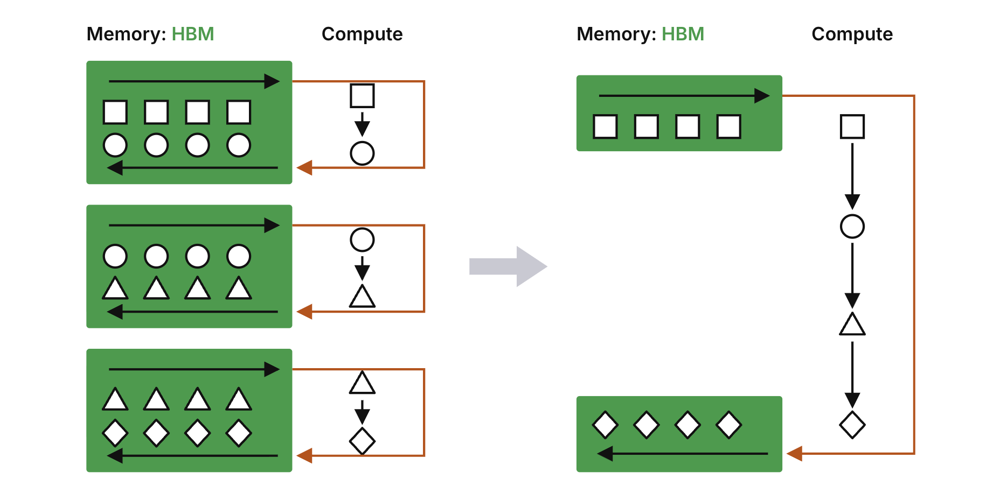

That suggests an obvious idea: what if we never stored those intermediate results in HBM at all, and instead chained every step together and wrote to HBM only once at the end? In terms of the matrix math, we'd read in q1, k1 and v1, compute the dot product q1·k1, and instead of writing it back, go straight to the next step: somehow turn it into the softmax probability p11, multiply p11 by v1, and add the result into o1. Then loop over k2 and v2, and so on up to N, and write only the final o vector back to HBM.

That's the intuition behind kernel fusion, shown in the right half of the diagram.

## A fused kernel, and an overflow problem

There's a fairly direct way to write this. In the code below, q is one row's query vector, and K and V are the full matrices. The variable d is the softmax denominator, starting at 0 (here d means the denominator, not the head dimension), and o is the output vector, starting at all zeros. The loop over k and v stands for reading one k and one v at a time from HBM into SRAM. x is q dotted with k, times scale, which is the \(1/\sqrt{d}\) scaling factor from the attention formula. Then `exp(x)` times v is added straight into o.

Why does that work? Softmax is `exp(x)` divided by the sum of all the exponentials. When we reach a given x, we don't know that sum yet, so we set it aside and use only the numerator as the weight on v, adding it into o. Once every x has been processed, d holds the full denominator, and we return o divided by d in one step. Since the denominator is the same number for the whole row, dividing before or after the sum gives the same result. We've only tracked the numerator's and the denominator's contributions to o separately, without changing o.

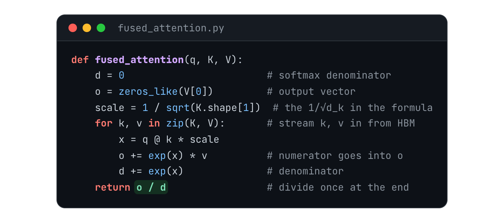

This is the fused kernel we were after. K and V are read from HBM only once, the intermediate values x, o and d don't grow with n so they all stay in SRAM, and only the final o is written to HBM. But it has a fatal flaw: `exp(x)` overflows. x is a dot product of two vectors, so its size is unbounded, while floating-point numbers have a limited range. In FP16, whose largest value is 65,504, \(e^{12}\) is already out of range. So real softmax implementations subtract a baseline m before taking the exponential, a trick called safe softmax. The two are clearly equivalent: it amounts to multiplying the numerator and the denominator by \(e^{-m}\). The usual choice is m = the maximum of all the x values. Then every \(x_i - m\) is at most 0, every \(e^{x_i-m}\) falls between 0 and 1, and the exponential can never overflow.

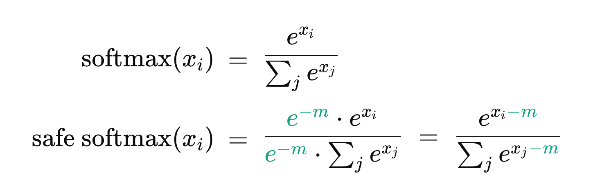

## Online softmax: three passes become two

Here's a straightforward implementation of safe softmax. It takes three passes. The first finds the row's maximum m. The second subtracts m from each value, takes the exponential and adds it into the denominator d. Only the third divides each term by d to produce the softmax. Here \(d_i\) is the sum of the first i terms, and every term subtracts the same baseline, \(m_N\), the maximum over the entire row. Since \(m_N\) is known only after scanning the whole row, the second pass can't start until the first one finishes.

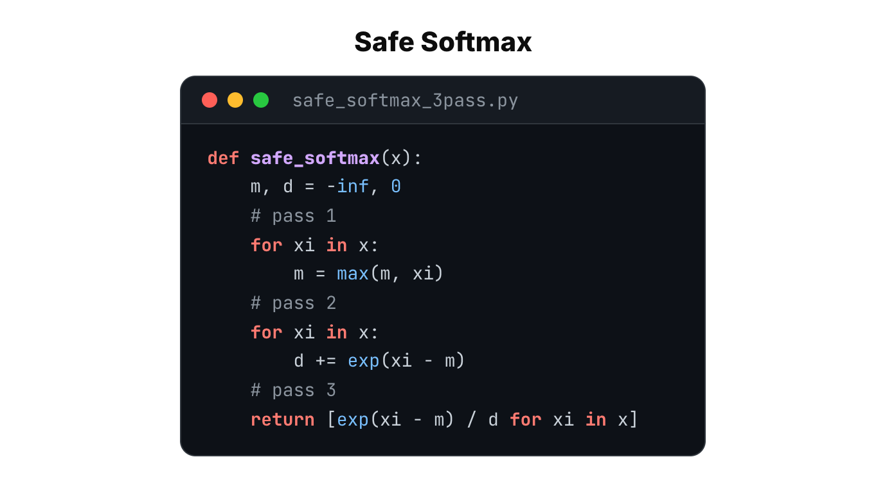

$$
d_i = \sum_{j\le i} e^{\,x_j-m_N}
$$

Is there a way to avoid all these passes? That's what online softmax does. If the global maximum \(m_N\) is what forces the extra pass, get rid of it. Redefine the denominator: let \(d'_i\) also be the sum of the first i terms, but have each term subtract \(m_i\), the maximum of the first i terms, instead of the global maximum. With that change, \(d'_i\) depends only on the first i terms, so it can be computed while scanning. And the \(d_N\) we ultimately need is the same thing as \(d'_N\), because at i = N the two definitions coincide.

$$
d'_i = \sum_{j\le i} e^{\,x_j-\textcolor{#0a7d61}{m_i}}
$$

The key is that with the new definition, \(d'_i\) and \(d'_{i-1}\) are linked by a recurrence: \(d'_i\) equals \(d'_{i-1}\) times a correction factor \(e^{m_{i-1}-m_i}\), plus \(e^{x_i-m_i}\). Every term in \(d'_{i-1}\) was computed against the baseline \(m_{i-1}\). Now the baseline changes to \(m_i\), so we multiply the whole old sum by the correction factor. When the exponents add, the \(m_{i-1}\) in the middle cancels, leaving \(e^{x_j-m_i}\), so every term now uses the new baseline. Then we add the i-th term against the new baseline, and that's the new \(d'_i\).

$$
\begin{aligned}
      d'_i &= d'_{i-1}\,\textcolor{#0a7d61}{e^{\,m_{i-1}-m_i}} + e^{\,x_i-m_i}\\[6pt]
      &= \Big(\sum\nolimits_{j\le i-1} e^{\,x_j-m_{i-1}}\Big)\textcolor{#0a7d61}{e^{\,m_{i-1}-m_i}} + e^{\,x_i-m_i}\\[4pt]
      &= \sum\nolimits_{j\le i-1} e^{\,x_j-m_i} + e^{\,x_i-m_i}
      \;=\; \sum\nolimits_{j\le i} e^{\,x_j-m_i}
    \end{aligned}
$$

So the online softmax code needs only a small change. It introduces `m_old` for the previous maximum, updates m, and then follows the recurrence: d becomes d times `exp(m_old − m)`, plus `exp(xi − m)`. The maximum m and the denominator d are now computed together in a single pass. Three passes have become two.

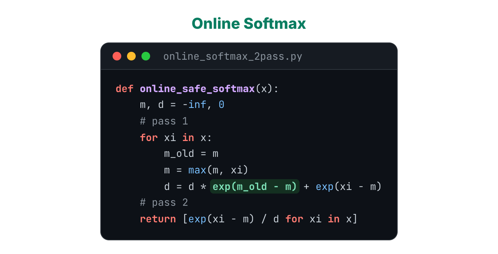

## FlashAttention: the same trick, applied once more

Now let's apply online softmax to attention. That gives the code below, which needs two passes. The first loops over every k vector and uses the recurrence to compute the maximum m and the denominator d. The second goes over K and V again, computes `exp(q·k·scale − m)` for each term as safe softmax defines it, weights v by it, and adds the result into o.

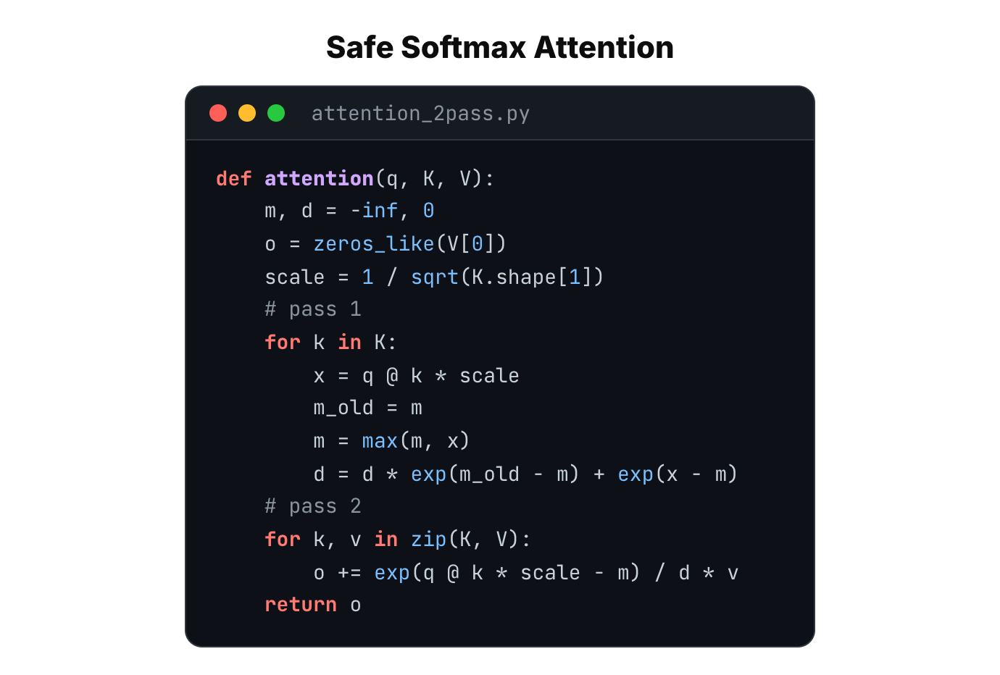

This version can't overflow, it's code that actually runs, and it needs only two passes compared with three for the naive approach. But can we go further? Look at how \(o_i\) is defined under safe softmax: every term uses the global maximum \(m_N\) and the global denominator \(d_N\). Doesn't that look a lot like \(d_i\) in the previous section? Can we use the same trick, redefining \(o_i\) so its terms no longer depend on the global maximum and the global denominator?

$$
\boldsymbol{o}_i = \sum_{j\le i}\frac{e^{\,x_j-m_N}}{d_N}\,\boldsymbol{v}_j
$$

We can. Define \(o'_i\) by replacing \(m_N\) and \(d_N\) with \(m_i\), the maximum of the first i terms, and \(d'_i\), the denominator of the first i terms. Now \(o'_i\) depends only on the first i terms, and the \(o_N\) we ultimately need is the same thing as \(o'_N\).

$$
\boldsymbol{o}'_i = \sum_{j\le i}\frac{e^{\,x_j-\textcolor{#0a7d61}{m_i}}}{\textcolor{#0a7d61}{d'_i}}\,\boldsymbol{v}_j
$$

Just as before, \(o'_i\) and \(o'_{i-1}\) are linked by a recurrence: \(o'_i\) equals \(o'_{i-1}\) times a correction factor, plus the i-th term's new contribution. The correction factor is \(d'_{i-1}\) times \(e^{m_{i-1}-m_i}\), divided by \(d'_i\). You can read it in two parts. The exponential in the numerator does the same job as before, switching the old baseline to the new one. The ratio of denominators swaps the old denominator for the new one. Multiplied together, they make this single factor.

$$
\begin{aligned}
      \boldsymbol{o}'_i &= \boldsymbol{o}'_{i-1}\,\textcolor{#0a7d61}{\frac{d'_{i-1}\,e^{\,m_{i-1}-m_i}}{d'_i}} + \frac{e^{\,x_i-m_i}}{d'_i}\,\boldsymbol{v}_i\\[8pt]
      &= \Big(\sum\nolimits_{j\le i-1}\frac{e^{\,x_j-m_{i-1}}}{d'_{i-1}}\boldsymbol{v}_j\Big)\textcolor{#0a7d61}{\frac{d'_{i-1}\,e^{\,m_{i-1}-m_i}}{d'_i}} + \frac{e^{\,x_i-m_i}}{d'_i}\boldsymbol{v}_i\\[6pt]
      &= \sum\nolimits_{j\le i}\frac{e^{\,x_j-m_i}}{d'_i}\boldsymbol{v}_j
    \end{aligned}
$$

From this recurrence we can write the code below. Compared with the two-pass version, it adds one line, `d_old = d`, to keep the denominator from before the update. The rest follows the recurrence directly: compute the new m and the new d, assemble the correction factor `rescale`, then set o to o times `rescale`, plus `exp(x − m)` divided by d, times v. Once q, k and v are read in from HBM, all the intermediate values x, m, d and o stay in SRAM. Nothing intermediate is read from or written to HBM until every k and v has been scanned and the final o vector is written back. And that's FlashAttention.

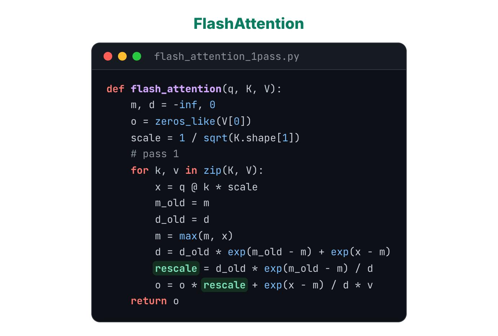

## Tiling: moving blocks, not vectors

To keep the explanation simple, we've been reading one q vector and one k, v pair at a time, computing one dot product at a time, and producing one output vector. A real GPU doesn't work that way, because it would leave both SRAM and the Tensor Cores mostly idle. In practice, FlashAttention splits Q, K and V into blocks of many vectors, called tiles, and sends a whole tile to the compute units at once. Where before each step produced one output vector o, now each step produces a batch of output vectors, a block of O. And since different rows of Q are completely independent, all of those outputs can be computed in parallel.

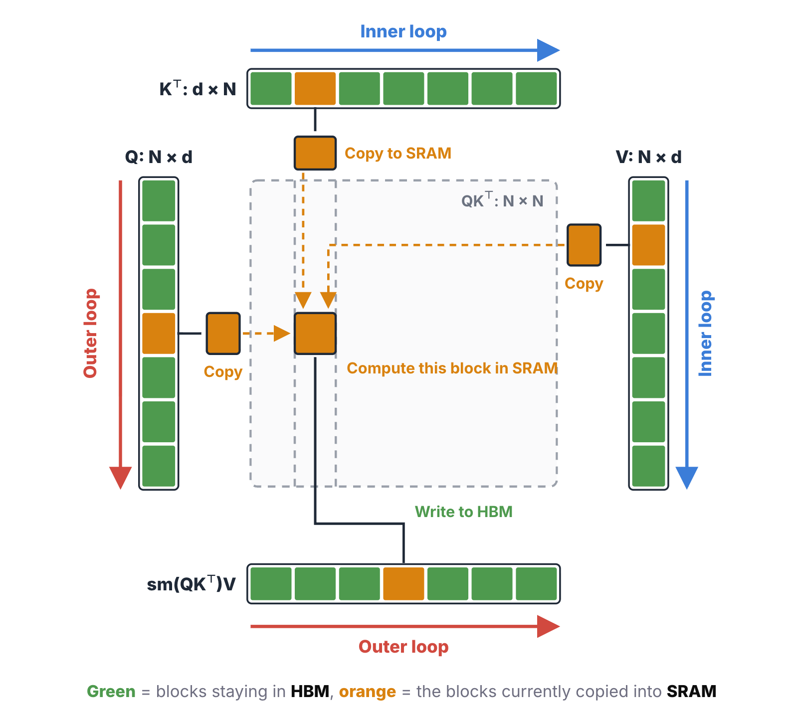

The code changes very little. The maximum m and the denominator d were scalars; now they're vectors, holding one maximum and one denominator per row. The output o was a vector; now it's a block of rows, a matrix. The rest is the same algorithm as before, just running on `tile_size` vectors in parallel instead of one. If the previous version made sense, this one needs no new ideas.

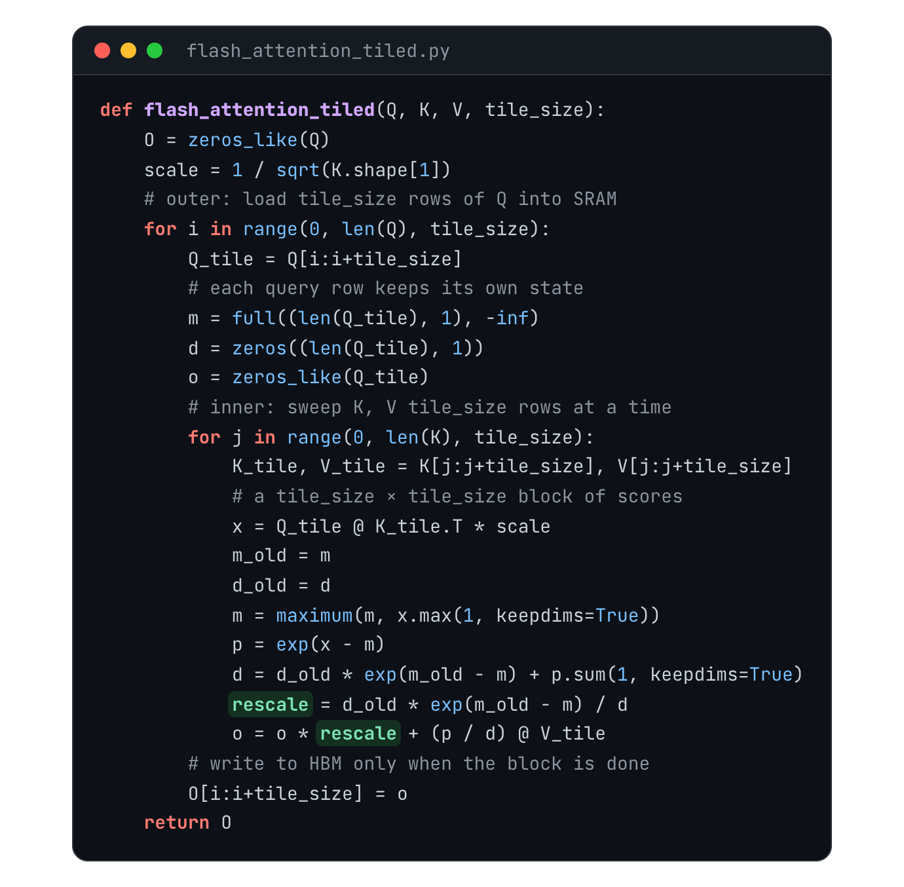

(The loop order here follows FlashAttention-2, with Q in the outer loop and K and V in the inner loop. The original FlashAttention paper put K and V on the outside.)

## What FlashAttention actually saves

To sum up, FlashAttention comes down to three techniques. The first is kernel fusion, which collapses the three round trips for computing scores, applying softmax and multiplying by V into one, so intermediate results never touch HBM. The second is online softmax, which uses a correction factor so that the denominator and the output can be computed while scanning, without waiting for the whole row. That's what makes the fusion possible in the first place. The third is tiling, which replaces "read one vector at a time" with "move one block at a time," so the SRAM and the Tensor Cores are actually kept busy.

Back to the question we started with. FlashAttention doesn't do less arithmetic. Every score in that \(n \times n\) table still gets computed, so attention is still \(O(n^2)\) work; it isn't true that FlashAttention turns attention into \(O(n)\). What it saves is all the extra data movement between HBM and SRAM. A lot of optimization on modern GPUs isn't about making them compute less. It's about making them wait less.

## References

1. Zihao Ye. [“From Online Softmax to FlashAttention.”](https://courses.cs.washington.edu/courses/cse599m/23sp/notes/flashattn.pdf) UW CSE 599M lecture notes, 2023.
2. Dao et al. (@tri_dao). [“FlashAttention: Fast and Memory-Efficient Exact Attention with IO-Awareness.”](https://arxiv.org/abs/2205.14135) NeurIPS 2022.
3. Tri Dao (@tri_dao). [“FlashAttention-2: Faster Attention with Better Parallelism and Work Partitioning.”](https://arxiv.org/abs/2307.08691) ICLR 2024.
4. Horace He (@cHHillee). [“Making Deep Learning Go Brrrr From First Principles.”](https://horace.io/brrr_intro.html) 2022.
5. Biao He (@hebiao064). [“What is Flash Attention?”](https://hebiao064.github.io/flash-attn) 2025.
