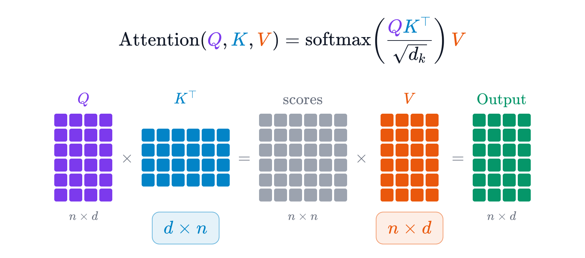
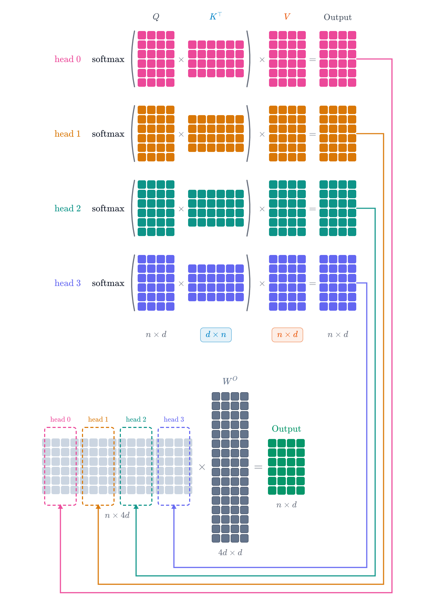
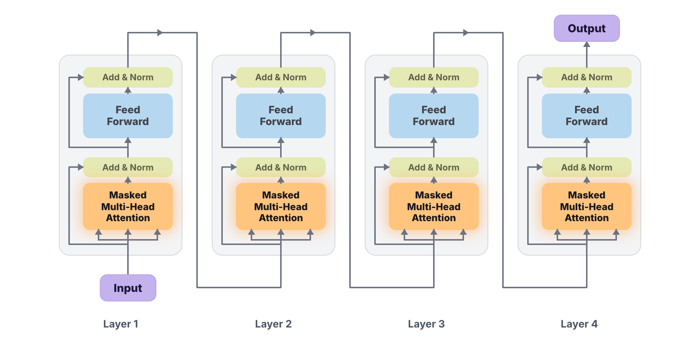
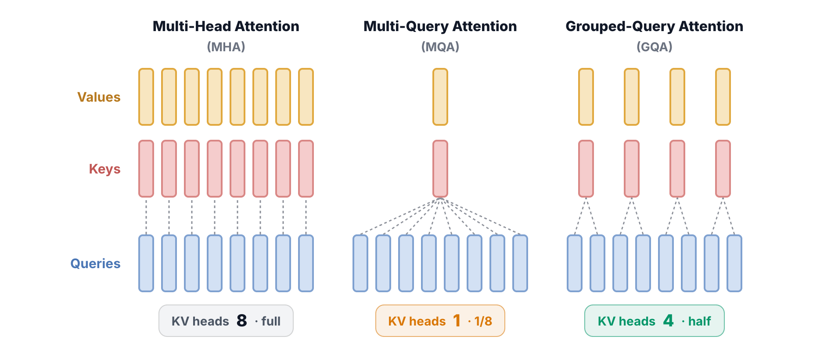
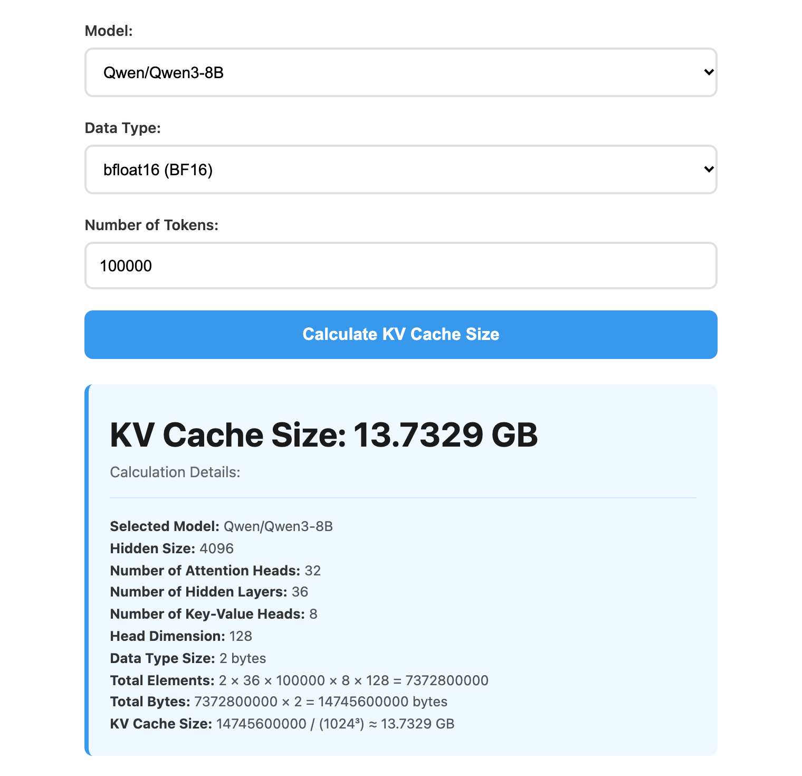

In my [last post](/posts/kv-cache-vs-prompt-cache/) I explained that a prompt cache stores the KV cache for your prompt. Several readers followed up with the obvious next question: how much physical GPU memory does that KV cache take up? And with memory chips as expensive as they are right now, how do you fit more context into the memory you have?

This post works out how big the KV cache is on a real inference server. We'll start from the simplest possible attention and build the formula up one factor at a time.

## A quick recap: what the KV cache stores

Inference in a Transformer revolves around attention, the mechanism that lets the model search the context for the tokens most relevant to the one it's about to generate. The token embeddings are projected into three matrices, Q, K and V. Multiplying Q by K transposed gives a table of scores, softmax turns those scores into weights, and the weights are used to take a weighted sum of the rows of V. That sum is the output.

During decode, each new token brings a fresh Query, which is compared against every earlier Key and then used to weight every earlier Value. The Query is new at every step and thrown away afterwards. K and V, on the other hand, are needed again for every token the model generates from then on, so they're kept. That's the KV cache.

Now some numbers. Say the prompt is \(n\) tokens long and each token's vector has \(d\) dimensions. Then K and V are each an \(n \times d\) matrix, and the memory the KV cache needs is:

$$
\text{KV cache} = \textcolor{#d97706}{2} \times n \times d \times \textcolor{#6b7280}{\text{bytes per element}}
$$

The 2 is there because we store two matrices, K and V. Bytes per element is how much space one number takes. With FP16, the most common format, that's 2 bytes.

## Multi-head attention: every head stores its own K and V

A single set of Q, K and V has a limitation: it can only judge how tokens relate from one angle. Language is full of different kinds of relationships. Which earlier word does "it" refer to? Who did something to whom? Is "Apple" the company or the fruit? One attention pattern struggles to capture all of these at once. What you tend to get is an average of them, which captures none of them precisely.

Multi-head attention fixes this. Instead of computing attention once, it splits attention into several heads, each with its own Q, K and V, so each head can look at the same input from a different angle in parallel.

Here's how the computation goes. Each head projects the tokens into its own Q, K and V and computes attention on its own. In this example there are 4 heads, so we get 4 output matrices, each \(n \times d\). We only want one output, though, so the 4 matrices are concatenated side by side into a single \(n \times 4d\) matrix, which holds everything the 4 heads found. A \(4d \times d\) projection matrix, \(W^O\), then turns it into the final output of multi-head attention.

(To keep the picture simple, each head here works in the full d dimensions. In real models each head usually works in a smaller slice, so the heads' dimensions add up to the model's width. Qwen3-8B, which we'll meet at the end, has 32 heads of 128 dimensions each, for a width of 4,096. From here on, \(d\) in the formula means the dimension of one head.)

The important part for memory is that every head computes its own K and V, and all of them have to be kept. So the KV cache grows by a factor of \(h\), the number of attention heads:

$$
\text{KV cache} = \textcolor{#d97706}{2} \times n \times d \times \textcolor{#d97706}{h} \times \textcolor{#6b7280}{\text{bytes per element}}
$$

## Stacked decoder layers: different K and V at every layer

Everything so far happens inside a single decoder layer. A real Transformer stacks many of these layers on top of each other.

Why stack them? In one attention layer, each token gets only one chance to mix in information from the context, and that's not enough to build much understanding. Language has to be understood in layers of abstraction. It's a bit like a convolutional network recognizing an image: the bottom layers see only pixels, the next layers assemble pixels into edges and textures, the layers above that combine those into eyes and ears, and only the top layers recognize the animal in the picture. Stacking many identical decoder layers lets a Transformer refine each token's representation the same way, step by step, into something more abstract and complete.

Every layer has the same structure. First comes the multi-head attention we just covered, then a feed-forward network, and each of the two is followed by an Add & Norm step: a residual connection plus normalization. Those steps mainly keep a network dozens of layers deep stable during training. They don't take part in attention and don't produce any K or V, so they don't affect the KV cache. The token embeddings enter the first layer, each layer's output becomes the next layer's input, and after the top layer the model uses the final output to predict the next token.

Because every layer has its own \(h\) sets of K and V, the formula picks up another factor, \(L\), the number of decoder layers:

$$
\text{KV cache} = \textcolor{#d97706}{2} \times n \times d \times \textcolor{#d97706}{h} \times \textcolor{#d97706}{L} \times \textcolor{#6b7280}{\text{bytes per element}}
$$

With this many factors, it's fair to ask whether every layer's K and V really need to be kept. They do. Every new token passes through the whole stack starting from the first layer, computing attention at each one. If any layer's K and V weren't cached, that layer's cost per decode step would jump from the order of \(n\) to the order of \(n^2\). However fast the other layers are, that one layer would hold up the whole decode, so the K and V of every layer have to stay.

## MQA and GQA: replacing h with h_kv

Multi-head attention is the most expressive option, since every head can look at the context from its own angle. The downside is just as clear: with many heads, each one storing its own K and V puts enormous pressure on memory. Engineers have come up with several ways around this.

The most aggressive is multi-query attention (MQA). Every head keeps its own Q, so the model still looks from many angles, but all the heads share a single K and V. That cuts the K and V you need to store by a factor of \(h\). The memory savings are real, but so is the cost: with every head attending through the same K and V, much of the benefit of having multiple heads is lost, and output quality drops noticeably.

The compromise is grouped-query attention (GQA), which is what most new models use today. Instead of giving every head its own K and V like MHA, or making every head share one like MQA, it splits the heads into groups, and each group shares one K and V. Pair up 8 heads, for example, and you only need 4 sets of K and V. Seen this way, MHA and MQA are both special cases of GQA: MQA is GQA with one group, and MHA is GQA with as many groups as heads. GQA gets the best of both, striking a good balance between expressiveness and memory.

That gives us the final formula, where \(h_{\text{kv}}\) is the number of K and V heads actually stored:

$$
\text{KV cache} = \textcolor{#d97706}{2} \times n \times d \times \textcolor{#059669}{h_{\text{kv}}} \times \textcolor{#d97706}{L} \times \textcolor{#6b7280}{\text{bytes per element}}
$$

## Checking the formula against a real calculator

We can check this against a real tool. The LMCache project has a KV cache calculator on its documentation site that works out the KV cache size for open models. With its default model, Qwen3-8B, the data type set to BF16 and the context set to 100,000 tokens, it reports that the KV cache for this one request takes 13.73 GB of GPU memory.

Qwen3-8B has 36 layers and 32 attention heads, but only 8 KV heads, and each head has 128 dimensions. BF16 takes 2 bytes per element. Plug those into the formula:

$$
\begin{aligned}
\text{KV cache} &= \textcolor{#d97706}{2} \times \underbrace{100{,}000}_{n} \times \underbrace{128}_{d} \times \underbrace{\textcolor{#059669}{8}}_{h_{\text{kv}}} \times \underbrace{\textcolor{#d97706}{36}}_{L} \times \underbrace{\textcolor{#6b7280}{2}}_{\text{bytes}}\\
&= 14{,}745{,}600{,}000\ \text{bytes} \approx 13.73\ \text{GiB}
\end{aligned}
$$

That's about 7.37 billion numbers, or 14.7 billion bytes. The calculator labels the result GB, but it divides by 1024³, so strictly speaking it's 13.73 GiB, or about 14.7 GB in decimal units. Either way, it matches the formula exactly.

(This counts only the K and V tensors themselves. The total memory a GPU process uses also includes the model weights, activations and runtime workspace, so this formula can't predict that total on its own.)

## References

1. Vaswani et al. (@ashVaswani). [“Attention Is All You Need.”](https://arxiv.org/abs/1706.03762) NeurIPS 2017.
2. Ainslie et al. [“GQA: Training Generalized Multi-Query Transformer Models from Multi-Head Checkpoints.”](https://arxiv.org/abs/2305.13245) EMNLP 2023.
3. LMCache (@lmcache). [“KV Cache Size Calculator.”](https://docs.lmcache.ai/getting_started/kv_cache_calculator.html) LMCache documentation.
4. Chi Zhang (@zhangchitc). [“KV Cache vs. Prompt Cache: What's the Difference?”](https://zhangchitc.github.io/posts/kv-cache-vs-prompt-cache/) 2026.
