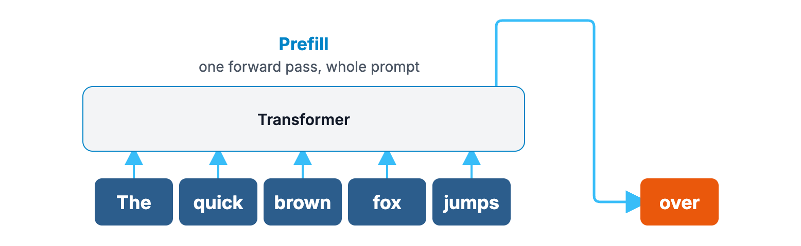
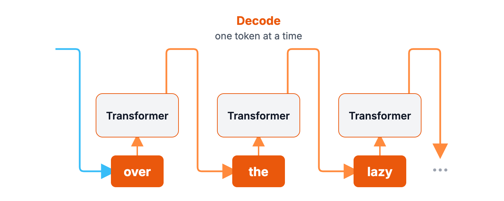
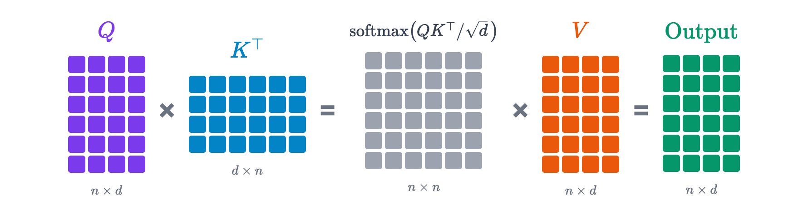
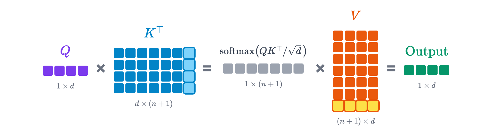
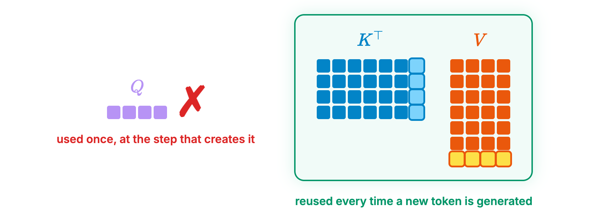
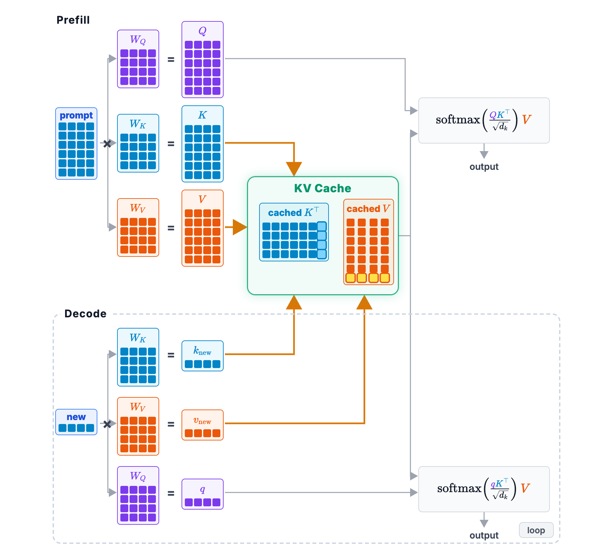
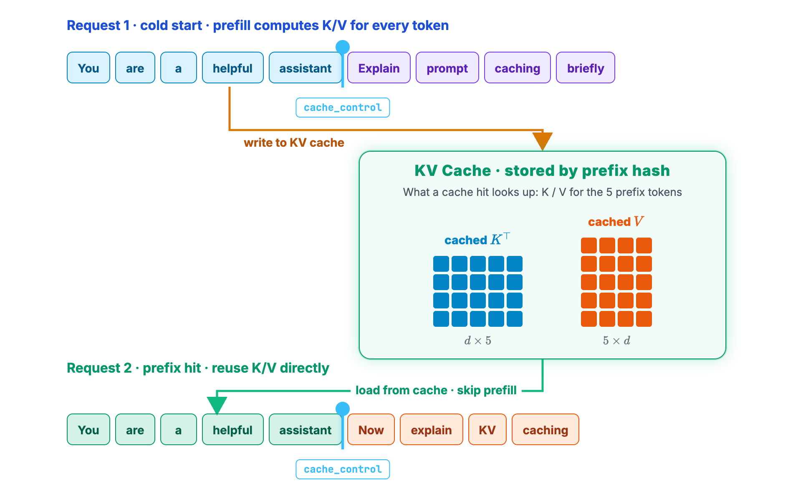
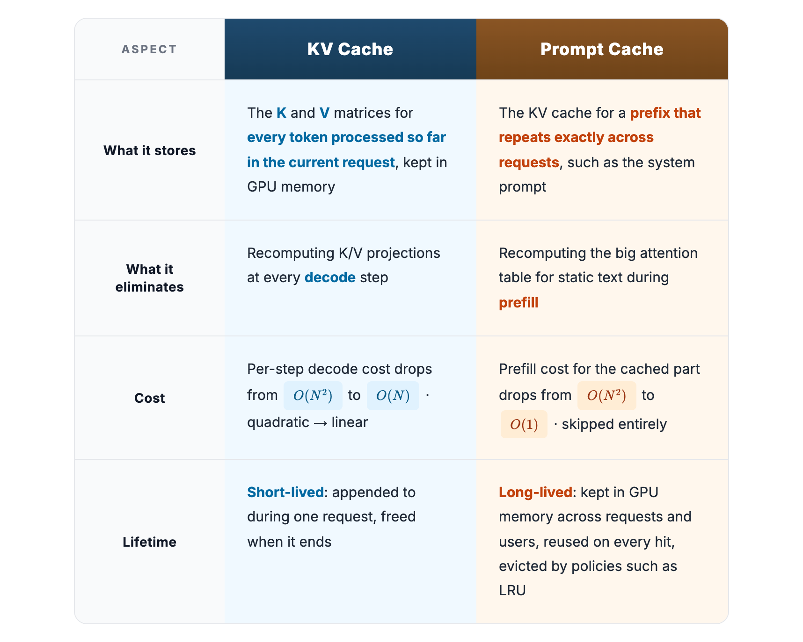

I've covered prompt caching a few times now, and the same questions keep coming back. Does the server save the model's previous answer? When my prompt prefix hits the cache, does the model skip running altogether and just hand back a stored response, like a database lookup?

Both come from common misconceptions about how LLMs work, and they boil down to the same question: what exactly is sitting in a prompt cache? Let's answer that properly. Along the way we'll meet its close cousin, the KV cache, and by the end the difference between the two will be clear.

## Two phases: prefill and decode

To get there, we need to start with how a Transformer generates a response. It happens in two phases.

The first is prefill. The model reads your entire prompt in one go, building up its understanding of the context as it reads, so it's ready to start answering.

The second is decode, where the model writes the answer. Here's the catch: even if your prompt is a thousand tokens long, prefill reads it all at once, but on the way out the model can only produce one token at a time. And before each new token, it has to look back over everything that came before: your whole prompt, plus every token it has generated so far. Generating text this way is called autoregressive.

Prompt caching mainly speeds up the first phase, prefill.

## A quick refresher on attention

To see why, we need to revisit attention, the core of the Transformer and the key to understanding the KV cache.

Attention exists because, when the model predicts the next token, the earlier words aren't equally important. It needs a way to tell which ones matter most right now.

Here's an example. The prompt is "The quick brown fox jumps", and the model has to predict what comes next. In the diagram, thicker arrows mean more attention. The thickest ones land on "quick", "brown" and "fox", while "The" and "jumps" barely register. The model outputs "over".

(The weights are illustrative, not measured from a real model.)

Why "over"? Because "The quick brown fox jumps over the lazy dog", the pangram that packs every letter of the alphabet into one sentence and is a staple of typing drills and font previews, appears in its training data more times than anyone can count. That co-occurrence is baked into its weights. Once it spots "quick brown fox" as the words that matter, "over" is the obvious next pick. That's attention in a nutshell: instead of treating every word equally, it weighs them by how much they matter at this moment.

So how is it computed? Every token gets projected into three vectors: a Query, a Key and a Value.

- The Query is what this token is looking for.
- The Key is what this token can offer.
- The Value is the information this token actually carries.

The names come from information retrieval and databases. The Query is like what you type into a search box, the Key is like an index key in a database, and the Value is the data you get back for that key.

The current token takes its Query and scores it against the Key of every earlier token. A higher score means that token is more relevant. Those scores then become weights for a weighted sum of all the tokens' Values. That's the whole attention computation, and the formula says exactly the same thing:

$$
\text{Attention}(Q,K,V)=\text{softmax}\!\left(\frac{QK^{\top}}{\sqrt{d_k}}\right)V
$$

- \(QK^{\top}\) is "score the current Query against every Key".
- Dividing by \(\sqrt{d_k}\) is a scaling trick from the original paper that keeps the scores from getting too large.
- The softmax normalizes the scores into weights that sum to 1.
- Multiplying by \(V\) is "take the weighted sum of every token's Value".

## What prefill and decode compute

Back to the computation. Say your prompt has \(n\) tokens, and each token's Q, K and V vectors have \(d\) dimensions. Stack the \(n\) Query vectors row by row and you get an \(n \times d\) matrix. The same goes for K and V.

Here's what prefill does. It computes all three matrices for the whole prompt. Then it multiplies Q by K transposed in a single step, producing an \(n \times n\) table of scores between every pair of tokens in the prompt. That table is used to weight the entire V matrix. The attention for the whole prompt is done in one shot.

Because that table is \(n \times n\), it grows quickly as the prompt gets longer. The amount of computation is huge, which is why prefill is limited by the GPU's raw compute.

Now decode. Generating one new token adds just one row for that token: its own Q, K and V, each a \(1 \times d\) vector. So the K and V matrices each grow by one row, to \(n+1\). The new token's Query is compared against every row of K, and the result is used to take a weighted sum over V.

The second token, the third, and every one after that work the same way: K and V keep growing by one row at a time. And all the earlier rows get used again for every single new token.

## What the KV cache stores, and how much it saves

Decoding one token at a time like this means recomputing K and V for every earlier token at every step. But once those K and V are computed, they never change. So engineers had the obvious idea: keep them around during decode. That's the KV cache.

Why store K and V but not Q? A token's Query is only used once, at the step that produces that token. At the next step there's a new token with a new Query, and the old one is useless, so storing it would be a waste. K and V, on the other hand, never change once computed and get pulled out again at every decode step, so they're worth keeping.

The KV cache exists to speed up every decode step. Let \(N\) be the current context length. Without a KV cache, every new token means recomputing everything for all \(N\) earlier tokens from scratch, which costs on the order of \(N^2\) per step. With a KV cache, the model only computes K and V for the one new token and reads the rest from the cache, bringing the cost per step down to the order of \(N\).

That's a factor of \(N\) less work per step. With a few thousand tokens of context, each step does thousands of times less work, and with tens of thousands of tokens, tens of thousands of times less.

## Prefill fills the cache, decode appends to it

With a KV cache in place, here's what the full inference process looks like.

During prefill, the model computes K and V for every token in the prompt at once and writes them into an empty KV cache. Prefill is where the KV cache gets initialized.

During decode, each new token only needs its own K and V, which are appended to the end of the cache. Decode keeps adding one row at a time.

In the diagram below, the orange arrows are writes: prefill fills the cache from above, and each decode step appends one row from below (the highlighted last column of \(K^{\top}\) and last row of V). The gray arrows on the right are reads: both the prefill and the decode attention take K and V straight from the cache.

So, back to the question we started with: what exactly is stored in a prompt cache? It's that KV cache, the one prefill builds after your prompt has gone through the Transformer. It's an intermediate result from halfway through the model's computation. It's not your last answer, and it's certainly not a string that can be handed straight back to you.

## What changes with a prompt cache

So far, the KV cache only removes repeated work within a single response. Inside one request, decode doesn't recompute the earlier K, V or attention. A prompt cache extends that reuse across requests.

What does that mean? Without a prompt cache, prefill starts from scratch for every new request. Your system prompt, your tool definitions, the earlier turns of the conversation: K and V get recomputed for every one of those tokens.

With a prompt cache, things change. Prefill notices that this request's prefix is identical to last time, so it pulls out the K and V it stored back then and uses them directly, skipping that whole stretch of attention computation. The model only has to process the small part you added this time. Once that's done, it joins up with the cached part and decode carries on as usual. (The blue marker in the diagram shows where the cached prefix ends, which Anthropic's API sets with `cache_control`.)

Note that a cache hit doesn't mean you get a ready-made answer. What it saves is the prefill computation. The model still has to generate every token of its reply. That's also why cached tokens are so much cheaper: you're not making the GPU recompute them.

## KV cache vs prompt cache

To wrap up, here's how the two compare.

In one sentence: the KV cache saves repeated decode work within a request, and the prompt cache saves repeated prefill work across requests. Used together, one covers decode and the other covers prefill.

## References

1. Vaswani et al. (@ashVaswani). [“Attention Is All You Need.”](https://arxiv.org/abs/1706.03762) NeurIPS 2017.
2. Sankalp (@dejavucoder). [“How prompt caching works: Paged Attention and Automatic Prefix Caching plus practical tips.”](https://sankalp.bearblog.dev/how-prompt-caching-works/) 2025.
3. vLLM. [“Automatic Prefix Caching.”](https://docs.vllm.ai/en/stable/design/prefix_caching/) vLLM documentation.
4. Gim et al. [“Prompt Cache: Modular Attention Reuse for Low-Latency Inference.”](https://arxiv.org/abs/2311.04934) MLSys 2024.
