When we judge how capable a model is, the first number we look at is its parameter count. Scaling laws back that instinct up: a model's loss falls predictably as you scale up model size, training data and compute together. The catch is that a bigger model also costs more compute, in training and in inference. Mixture of Experts, or MoE, breaks that link. It lets a model's parameter count grow tens of times over while the compute spent on each token barely moves. The Switch Transformers paper puts it this way: "a sparsely-activated model -- with outrageous numbers of parameters -- but a constant computational cost." Today almost every flagship open model, DeepSeek, Qwen and Kimi among them, is built on it. This post walks through how it works, one step at a time.

## Dense models: every parameter in the FFN does work for every token

I've covered the Transformer decoder in earlier posts, so here's a quick recap. A decoder layer has two main blocks. The input first goes through multi-head attention, whose job is to move information between tokens. It then goes through the FFN, the feed-forward network. Once each token has picked up its context, the FFN mixes and transforms that information to produce the layer's output. Attention is the only block in a Transformer that looks across tokens. The FFN treats every token independently, so all tokens can go through it in parallel.

Inside the FFN, each token's \(d\)-dimensional vector is first projected up to a wider intermediate size, \(d_{\mathit{ff}}\). A nonlinear activation function is applied in that wider space, and the result is projected back down to \(d\) dimensions.

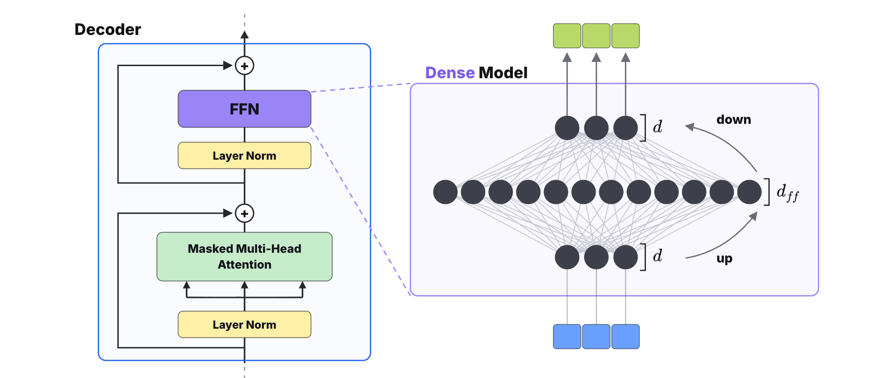

In matrix form, say the prompt has \(n\) tokens and each token is a \(d\)-dimensional vector. The input \(X\) is an \(n \times d\) matrix. Multiplying it by the up-projection \(W_1\) gives an \(n \times d_{\mathit{ff}}\) intermediate result. After the activation, multiplying by the down-projection \(W_2\) brings the output \(Y\) back to \(n \times d\). The shape that goes in is the shape that comes out.

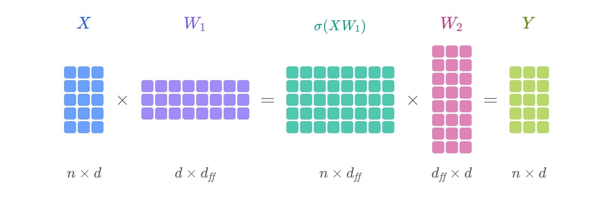

(The sizes in these diagrams are illustrative. In real models \(d\) is in the thousands.)

An FFN built this way is what makes a dense model: every token goes through the same complete network, and every neuron and every parameter in the FFN takes part in the computation. So the bigger the model, the more compute each token needs. In a dense model, adding parameters means adding compute.

## Sparse models: four experts, and each token uses one

A sparse model does it differently. It makes many copies of the FFN, and each copy is called an expert. When the model runs, each token goes through only one of them.

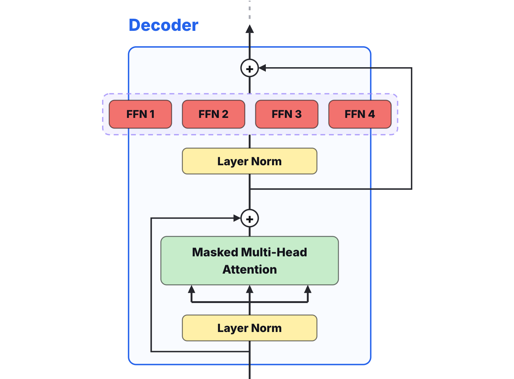

Take the prompt "What is 1 + 1 ?" and four experts that handle punctuation, verbs, conjunctions and numbers. When the sparse model sees that the current token is most closely related to numbers, it sends the token to the numbers expert. The other three experts sit idle and do no computation at all, and the output of the whole sparse layer is the numbers expert's output.

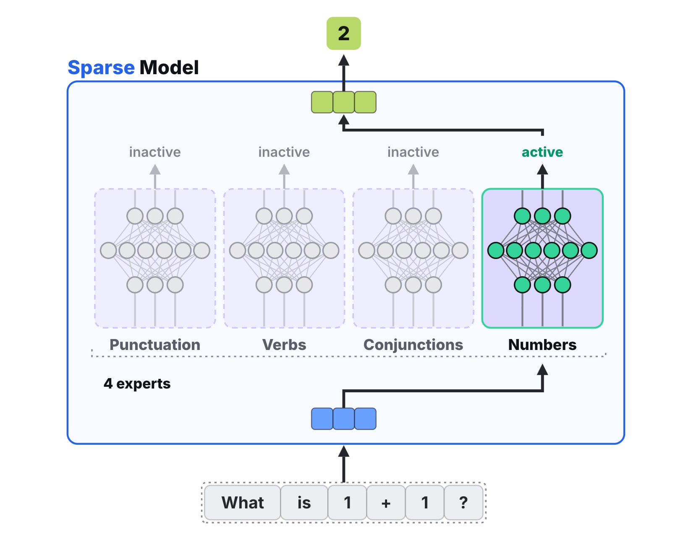

(The expert labels are for illustration. Real experts don't divide the work this neatly: the Mixtral paper found no clear specialization by topic.)

At its core, then, a sparse model picks a compute path based on its input. Each token activates only part of the model's parameters, which is how the total parameter count can grow without adding compute per token.

Compare that with the multi-head attention block. Whatever the input looks like, every head computes its attention. The results of all the heads are concatenated into one large matrix, and a linear projection turns that into the block's output. So of the two blocks in a decoder layer, attention puts every one of its neurons to work, while the sparse layer uses only some of them.

## Routing: a router scores the experts, and the top one runs

That raises the key question: who decides which expert a token goes to? MoE adds a component for this called the router. It is a small layer followed by a softmax. Its input is the token's vector, and its output is \(E\) numbers, one probability per expert. The higher the probability, the better suited the router thinks that expert is for this token.

Say a token comes in and the router's softmax gives the four experts probabilities of 0.45, 0.19, 0.05 and 0.31. The first expert scores highest, so the token goes to expert 1, and that expert's output is multiplied by its probability, 0.45, to give the layer's output.

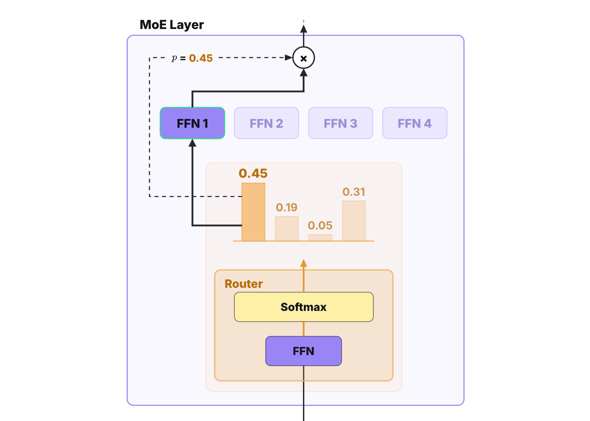

That multiplication matters. Picking the expert means taking the maximum, and taking a maximum can't be differentiated, so no gradient flows back through the choice itself. Multiplying by 0.45 puts the probability into the formula for the output. The gradient can then flow back through that multiplication into the router's parameters and tell it whether this choice was a good one.

In matrix form, if the input is an \(n \times d\) matrix, the router produces an \(n \times E\) matrix, and softmax is applied to each row. Each row is one token's probability distribution over the \(E\) experts.

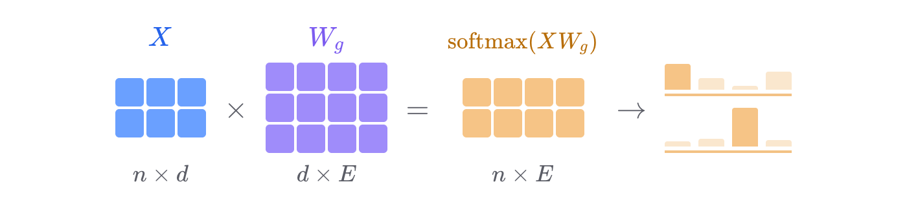

The router box in the figure is labeled FFN, but in Mixtral and Switch Transformers the router is in fact a single linear layer: one \(d \times E\) matrix, \(W_g\) above, followed by the softmax.

## The forward pass: dispatch, then combine

Now let's follow one complete forward pass through an MoE layer. The input is six tokens, a 6×3 matrix, and each token gets a color tag so we can track where it goes.

Next the router scores them, producing a 6×4 matrix. Each row holds one token's probabilities for the four experts, and the highest cell in each row is highlighted in that expert's color. t1's highest score is 0.62, for expert 2. t2's is 0.70, for expert 1.

Then comes the important step, dispatch. Following the experts just chosen, the six tokens are regrouped into four piles. t2 and t5 both went to expert 1, so they are pulled out into a new matrix of their own. In the same way, t1, t4 and t6 are rearranged into a separate matrix that becomes expert 2's input, and t3 goes to expert 4. Notice that expert 3 got no tokens at all, so its input is empty.

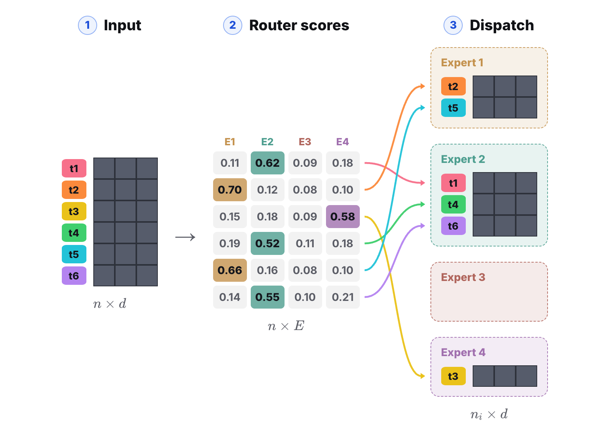

Each expert then runs its FFN on its own input matrix and multiplies every row of the result by the probability that token was routed with. The last step, combine, puts all the weighted outputs back in the tokens' original order, so each position again holds the result for the token that started there.

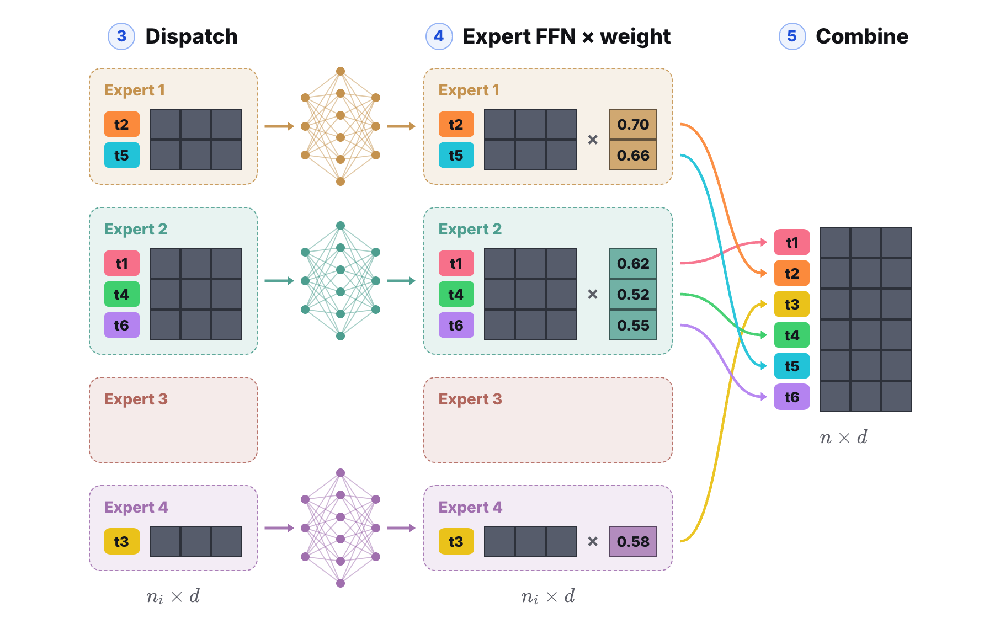

The dispatch and combine steps look a lot like MapReduce from distributed computing. Much as attention's query, key and value borrow from information retrieval, ideas from classic algorithms turn up all over the LLM stack.

One thing to keep in mind from this example: how many tokens each expert receives is decided entirely by the data. The counts are naturally unequal and can even be zero. This is one of the central problems in MoE models, load balancing, and we'll come back to it shortly.

## Top-K: several experts, added up by weight

Routing each token to a single expert has a weakness. A model that can send its input through only one expert is limited in what it can express. When several experts score about the same, a tiny difference in routing scores can send a token down a completely different path. That easily makes training unstable and feeds the load-balancing problem we just saw. So real models pick more than one expert, usually the \(K\) with the highest scores. DeepSeek-V4-Pro has 384 experts and activates 6 of them for each token. Kimi-K3 picks 16 out of 896. Mixtral, by comparison, picks 2 out of 8. The number of experts has grown much faster than \(K\), so each token touches a smaller and smaller share of the model.

Top-K routing changes little in the computation. The one new step comes after the top \(K\) experts are chosen: their weights are renormalized. In the left example, the two highest probabilities are 0.45 and 0.31. Before the outputs are combined, 0.45 is divided by their sum, 0.76, to get 0.59, and 0.31 divided by 0.76 gives 0.41. These renormalized weights are what the two experts' outputs are multiplied by and added up with. The right column runs the same steps for the token "is", which lands on two different experts.

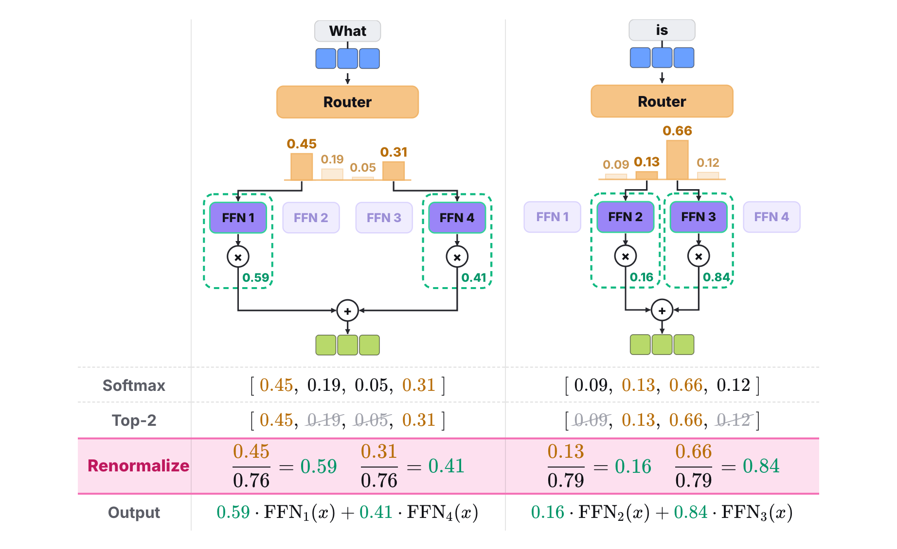

## Load balancing: how collapse happens, and how it's kept in check

We saw in the forward pass that different experts get different amounts of work. An expert that isn't chosen gets no gradient at all, and that sets up a feedback loop. At the start of training the router is randomly initialized. Some expert happens to receive a few more tokens, so it gets a little more gradient and its parameters improve a little more. At the next step the router is more inclined to pick it, so it receives a few more tokens still. The router gradually funnels tokens to a handful of experts, and the rest, rarely chosen, barely get trained. Shazeer et al. described this back in 2017: the gating network "tends to converge to a state where it always produces large weights for the same few experts." We want every expert to receive roughly the same number of tokens, so that all of them get trained. This is load balancing in MoE: keeping the network from leaning on a few experts.

The fix is an auxiliary loss built from two quantities, \(P_i\) and \(f_i\). \(P_i\) is the average probability the router gives expert \(i\) across the tokens in a batch.

$$
P_i=\frac{1}{n}\sum_{x\in B}p_i(x)
$$

On the left of the table below is an unbalanced router. \(P_1 = 0.58\) is the average of the first probability across the four tokens' distributions, so \(P_i\) shows that the router strongly favors expert 1 and gives the others little. On the right, with balanced routing, each expert's average probability hovers around a quarter, 0.25.

\(f_i\) is the fraction of tokens in the batch that the router actually sends to expert \(i\), which is how much traffic that expert gets in practice.

$$
f_i=\frac{1}{n}\sum_{x\in B}\mathbf{1}\{\arg\max p(x)=i\}
$$

On the left, expert 1's average probability is only 0.58, but it is always the largest one, so the router picks it every time. Its traffic is 100%, \(f_1 = 1\): one expert takes everything. On the right, \(f\) is four 0.25s, since each expert is picked once.

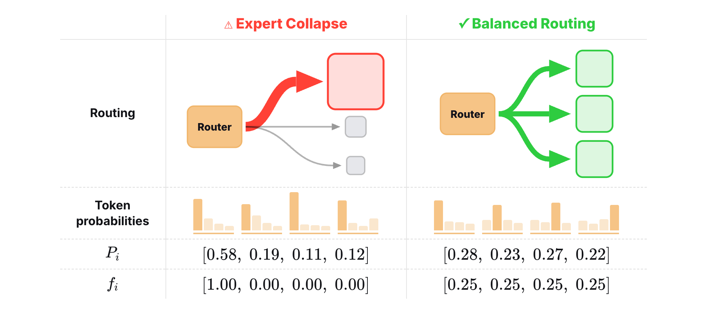

The auxiliary loss is \(\alpha\) times the number of experts \(E\) times the sum, over all experts, of \(f_i\) times \(P_i\).

$$
\text{Auxiliary Loss}=\alpha\cdot E\sum_{i=1}^{E} f_i\,P_i
$$

On the left, only the first expert contributes: \(4 \times 1 \times 0.58 \approx 2.33\) (\(P_1\) is 0.5825 before rounding). The right is easy to see too. Every \(f_i\) is 0.25, so \(E \cdot f_i = 1\), and the \(P_i\) add up to 1 because every token's probabilities do. When the load is perfectly balanced, the loss reaches its minimum of 1. The table shows the part after \(\alpha\); Switch Transformers sets \(\alpha\) to \(10^{-2}\), so the terms added to the total loss are about 0.0233 and 0.01. The product matters because \(f_i\) is a count and can't be differentiated, while \(P_i\) comes straight from the softmax and can. Adding this term to the total loss gradually evens out how many tokens each expert gets during training.

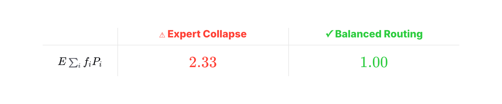

## Summary: more experts, without more of them per token

Back to the question we started with. A dense model can only add parameters by making its FFN wider, and every bit of extra width is extra compute for every token. MoE instead makes more copies of the FFN. The number of experts can grow very large, while the number each token activates doesn't have to grow with it. That is how parameter count and compute come apart: the parameters grow tens of times over while the compute per token barely moves.

## References

1. Noam Shazeer et al. (@NoamShazeer). [“Outrageously Large Neural Networks: The Sparsely-Gated Mixture-of-Experts Layer.”](https://arxiv.org/abs/1701.06538) ICLR 2017.
2. William Fedus et al. (@LiamFedus). [“Switch Transformers: Scaling to Trillion Parameter Models with Simple and Efficient Sparsity.”](https://arxiv.org/abs/2101.03961) JMLR 2022.
3. Maarten Grootendorst (@MaartenGr). [“A Visual Guide to Mixture of Experts (MoE).”](https://newsletter.maartengrootendorst.com/p/a-visual-guide-to-mixture-of-experts) 2024.
