On January 27, 2025, Nvidia lost nearly $600 billion in market value in a single day, the largest one-day loss in US stock market history, and DeepSeek set it off. People were stunned to learn that DeepSeek-V3, the base model behind DeepSeek-R1, had been trained for less than a tenth of what GPT-4 reportedly cost, yet it matched GPT-4o on benchmarks. How could it be so cheap? One of the key pieces of its architecture is Multi-Head Latent Attention, or MLA, which drastically cuts the memory that attention needs, above all the KV cache at inference time. This post takes MLA apart one step at a time.

## Multi-head attention: every head caches its own keys and values

I've covered [how much memory the KV cache takes](/posts/kv-cache-memory/) in an earlier post, so here's a quick recap. During Transformer inference, multi-head attention stores the key and value vectors it computes for every token. That's the KV cache, and the longer the context, the more memory it takes. Each head has its own keys and values. If the Transformer has \(L\) decoder layers, each with \(h\) heads of dimension \(d_h\), the KV cache for one token holds:

$$
\begin{aligned}
\text{KV cache per token}&=2\times L\times h\times d_h\\
&=2\times L\times 128\times 128=32{,}768\,L
\end{aligned}
$$

Take DeepSeek-V2 as an example. It has 128 attention heads, each 128-dimensional, so \(2 \times 128 \times 128\) means every token takes \(L \times 32{,}768\) elements. That's the problem with multi-head attention: the KV cache takes far too much memory.

There are some direct fixes for this. The middle diagram below is Multi-Query Attention, or MQA: every query head shares a single set of keys and values, so the number of KV heads drops to 1. That certainly saves memory, but the cost is just as direct. All the attention heads now work from the same keys and values, which takes away much of the point of having multiple heads and can hurt the quality of the model's output. On the right is Grouped-Query Attention, or GQA. The query heads are split into groups, and the heads in a group share one set of keys and values, so the number of KV heads falls to a fraction of what it was. GQA is the general form of MQA, and the cost is the same in kind: several heads have to share one set of K and V matrices, the differences between those heads are shaved away, and model quality becomes a trade-off.

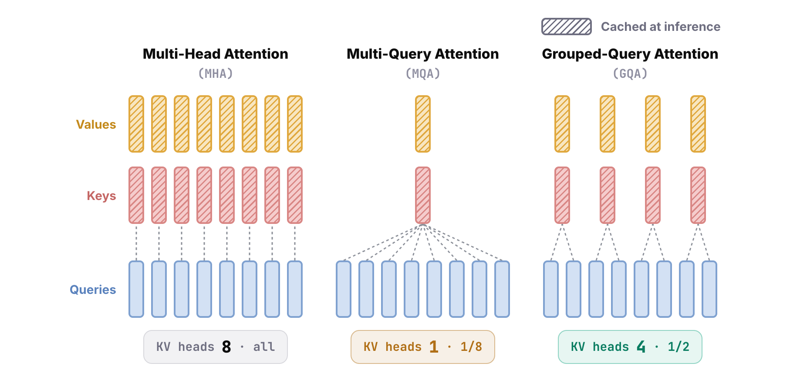

(The diagrams use 8 query heads to keep them readable.)

## Low-rank joint compression: cache one latent vector

Is there any other way to shrink the KV cache besides MQA and GQA? DeepSeek came up with a new one, called low-rank key-value joint compression. The core idea is to compress each token's vector first. The compressed result is called a latent vector, and the KV cache stores this latent instead of the keys and values. Later, when the attention scores are computed, every head's keys and values are decompressed, that is, projected back out, from the latent. "Low-rank" means the latent has a very small dimension, far smaller than the total size of all the keys and values. "Joint" means the keys and values aren't compressed and decompressed separately; they share a single compressed latent. Attention computed with low-rank joint compression is Multi-head Latent Attention, MLA.

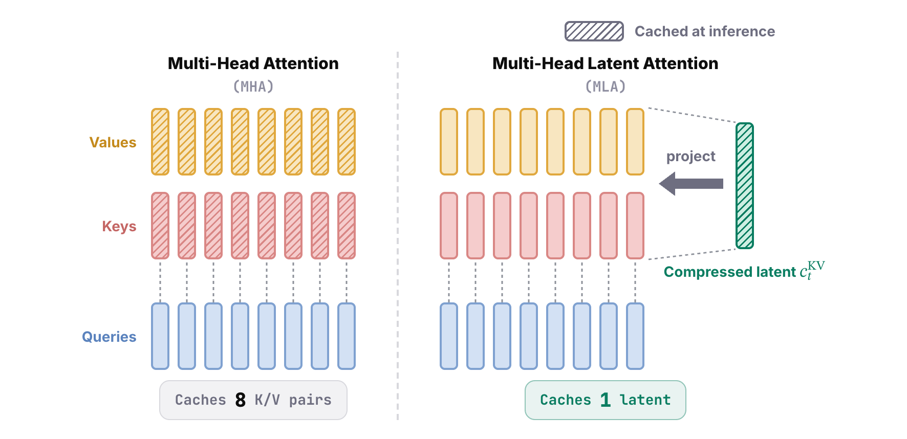

Call the latent's dimension \(d_c\). Then MLA's KV cache for each token becomes:

$$
\text{KV cache per token}=L\times d_c=512\,L
$$

DeepSeek-V2's latent has 512 dimensions, so each token takes only \(L \times 512\) elements. Compare that with the \(L \times 32{,}768\) for multi-head attention earlier: it's 1/64 of what plain multi-head attention needs.

## The definitions: project down, then up

So how exactly is the latent computed? Let \(h_t\) be the current token's input vector, which has 5,120 dimensions in DeepSeek-V2. The latent \(c_t^{KV}\) is a down-projection matrix \(W^{DKV}\) times \(h_t\); the D stands for down. The latent has 512 dimensions, a tenth of the input, and it's what gets cached at inference. When multi-head attention needs the keys and values, it multiplies the latent by the up-projection matrices \(W^{UK}\) and \(W^{UV}\) to get \(k_t\) and \(v_t\); the U stands for up. The key and value vectors have 16,384 dimensions, but logically they're 128 heads of 128 dimensions each, concatenated into one \(128 \times 128\) vector to make the computation convenient.

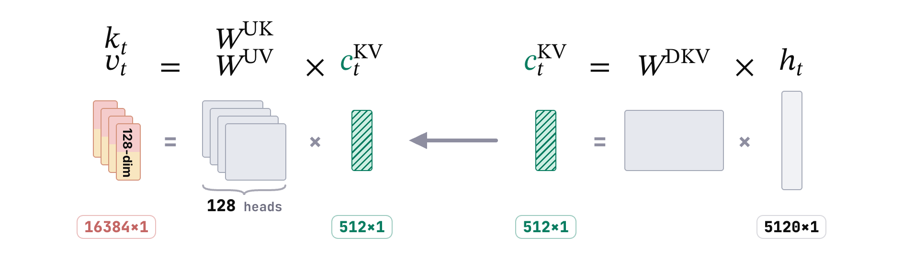

(The shapes are illustrative, not to scale.)

At this point you might wonder whether compressing the KV cache this hard also sacrifices model quality. Go back to the original multi-head attention. There, too, the keys and values are projections of the input vector \(h_t\). But \(h_t\) isn't designed only for attention. The FFN and every later decoder layer use it as well, so think of it as the data bus of the Transformer, of which attention only needs a part. MLA takes advantage of exactly that. The latent vector is designed to capture the information that actually needs to go into attention, while the full multi-head structure is kept: different heads can still have different keys and values, so architecturally it's a complete multi-head attention. What it compresses away is mostly information that never needed to enter attention, so the effect on output quality is small. (MLA is trained with this architecture from the start; this isn't a claim that any multi-head attention model could be squeezed into 512 dimensions without loss.)

Low-rank compression works on the query too, not just on the keys and values. Multiplying the input \(h_t\) by a down-projection matrix \(W^{DQ}\) gives the query latent \(c_t^Q\), which has 1,536 dimensions. When attention needs the query, \(c_t^Q\) is multiplied by the up-projection matrix \(W^{UQ}\) to get \(q_t\). There are a lot of symbols here, but you only need to hold on to the two latent vectors; everything revolves around them. Like the keys, \(q_t\) has 16,384 dimensions, again 128 heads of 128 dimensions.

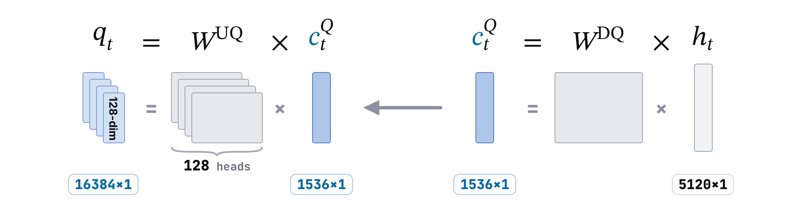

You may have noticed that the query never goes into the KV cache: \(c_t^Q\) can be thrown away as soon as it's used. So why compress it? It does nothing for inference. Compressing the query pays off in training. During training the intermediate results of every layer are kept for backpropagation, and squeezing the query down to 1,536 dimensions reduces the memory those activations take. So the KV compression shrinks the KV cache at inference, and the query compression shrinks the activations during training.

## Matrix absorption: compression that also saves compute

Low-rank joint compression doesn't just shrink the KV cache. It can also cut the compute at inference dramatically. That may sound backwards. Compression normally means decompression, so with every new token, attention now has to decompress on top of its usual work, which should add a lot of computation. This is where a trick called matrix absorption comes in. Say the latest token is token \(i\). To predict the next token, we dot \(q_i\) with the key of every earlier token. Each term \(q_i \cdot k_j\) can be written as \(q_i^{\top} k_j\). Now replace \(k_j\) with its compressed definition, \(W^{UK} c_j^{KV}\). Matrix multiplication is associative, so we can move the parentheses and compute \(q_i^{\top} W^{UK}\) first, then multiply the result by \(c_j^{KV}\). Both forms give exactly the same result; only the order of the computation changes.

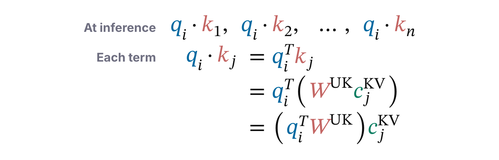

What difference does the order make? Suppose there are 100 tokens before the current one, and compare the two ways of computing. On the left, \(W^{UK}\) is merged into the key, which is the original order. For every earlier token, step one computes \(W^{UK} c_j^{KV}\). That matrix multiplication costs \(16{,}384 \times 512 \times 1\), because \(W^{UK}\) is a \(16{,}384 \times 512\) up-projection matrix. Step two multiplies the result by \(q_i^{\top}\), which costs \(1 \times 16{,}384 \times 1\). Both steps run for every earlier token, so 100 tokens cost the two steps added together, times 100. The exact count doesn't matter; what to notice is that step one is a very expensive matrix multiplication.

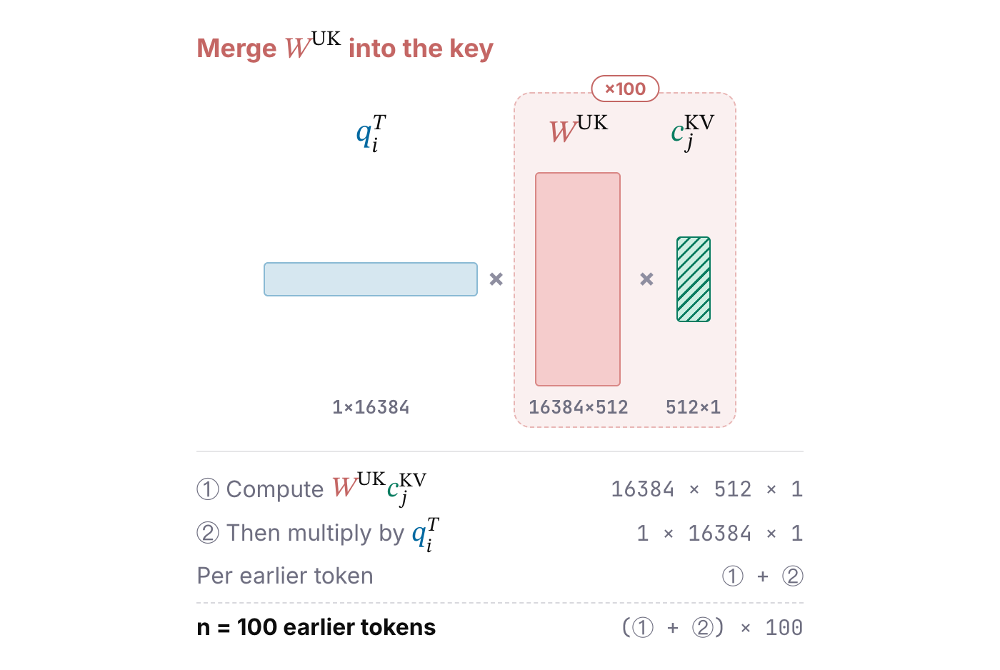

Now see what happens when \(W^{UK}\) is merged into the query. Step one multiplies \(q_i^{\top}\) by \(W^{UK}\), which costs the same \(16{,}384 \times 512 \times 1\). But once \(W^{UK}\) is merged into the query, it doesn't have to be done again: the result is kept and multiplied by each earlier token's latent \(c_j^{KV}\). Each of those dot products costs only \(1 \times 512 \times 1\), so the total is step one plus step two times 100. The expensive step runs only once, and what's left in the loop is a small dot product in the latent's tiny dimension. Put the two orders side by side, and at \(n = 100\), merging \(W^{UK}\) into the query does roughly 100 times less work. The longer the context, the bigger the gap.

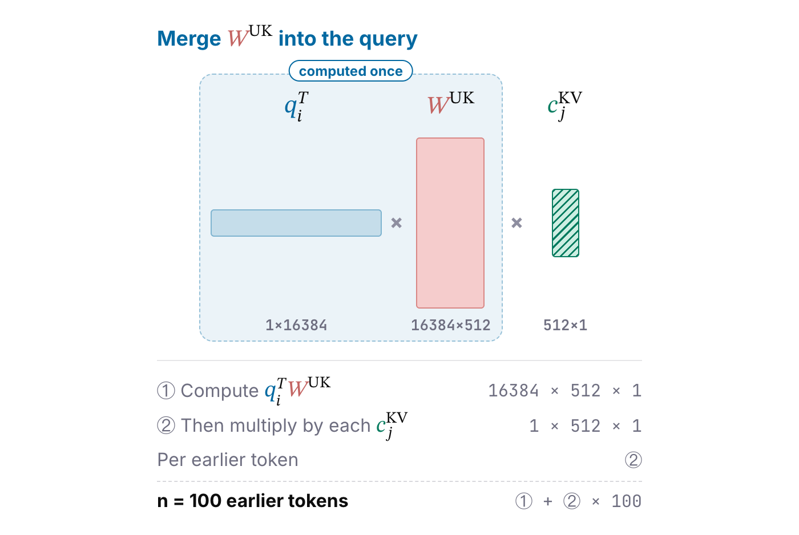

At heart, matrix absorption is what programmers call hoisting a loop invariant. \(W^{UK}\) is the same for every key, so it shouldn't be computed \(n\) times inside the loop; it should be moved out of the loop and computed once. Low-rank compression keeps the cached tokens small, and matrix absorption means they never have to be decompressed. Together, these two are why MLA saves both memory and compute.

## The RoPE conflict: a different rotation at every position

MLA looks perfect so far, but we've forgotten one thing: positional encoding. Nearly all of today's frontier models use rotary position embedding, RoPE, which rotates the query and the key by an angle that depends on each token's position. Let's add it to the formula. \(q_i\) becomes \(\mathrm{RoPE}(i)\,q_i\), \(k_j\) becomes \(\mathrm{RoPE}(j)\,k_j\), and then we take the dot product. Expanding it, the transposed query becomes \(q_i^{\top}\) times \(\mathrm{RoPE}(i)^{\top}\). The steps in between are the standard RoPE manipulations, which I derived in full in [the RoPE post](/posts/rope/), so I won't repeat them here. In the last step, we expand \(k_j\) into \(W^{UK}\) times the latent \(c_j^{KV}\).

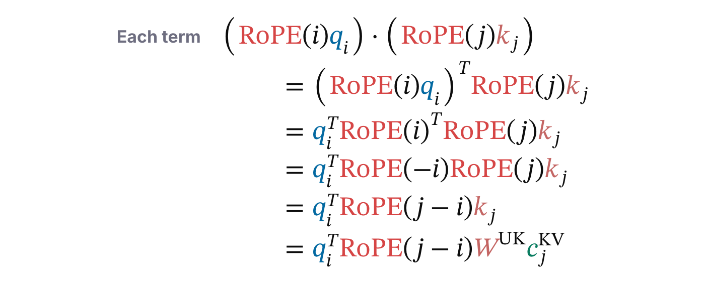

The trouble is that \(\mathrm{RoPE}(j-i)\). If we try to absorb the matrix as before, it no longer works, because this RoPE matrix now sits between \(q_i^{\top}\) and the projection matrix \(W^{UK}\), and it changes with the token on the right. Associativity still holds, but every time \(c_j^{KV}\) changes, \(\mathrm{RoPE}(j-i)\) changes with it, so there's no way to precompute a single left-hand result that's independent of \(j\). All that's left is to compute everything in the original order. Adding RoPE breaks matrix absorption and sends the dot products back to the original, expensive dimension. So how do we fix it?

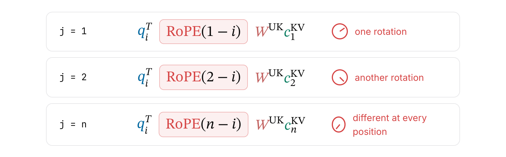

## Decoupled RoPE: content and position in separate branches

Since mixing RoPE into the content projections causes the problem, DeepSeek's answer is to separate them. Every head's key and query are split into two parts. The first is the content branch: the keys and queries projected from the latents as before. This part gets no RoPE at all, so matrix absorption works as usual. The second is the RoPE branch, dedicated to encoding position. When the two parts are concatenated and dotted together, the result is exactly the sum of the two parts' separate dot products, so the attention score becomes the content score plus the RoPE score. This is called decoupled RoPE.

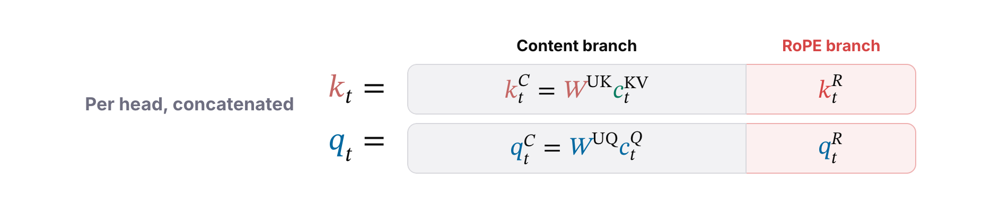

So how is the RoPE branch computed? For the key, the input vector \(h_t\) is multiplied by a new projection matrix \(W^{KR}\) and then rotated by RoPE according to the token's position, giving \(k_t^R\). It never goes through the latent's compression and decompression. It has only 64 dimensions, half the size of the content part \(k_t^C\), and all heads share this one copy. For the query, the starting point is the query latent \(c_t^Q\), which is multiplied by the projection matrix \(W^{QR}\) and then rotated, giving \(q_t^R\). It has 8,192 dimensions, which logically means 128 heads of 64 dimensions each. In all these symbols, the R stands for rotate.

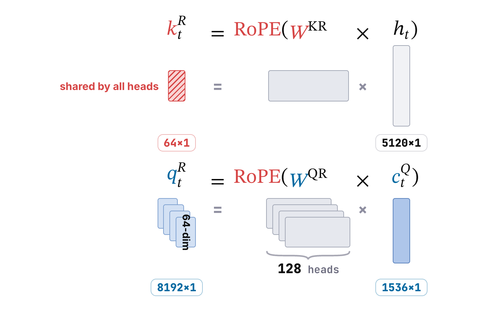

Why does the RoPE branch give the key only one copy, but the query one per head? It comes down to the fact that \(k_t^R\) has to go into the KV cache. It isn't decompressed from the latent \(c_t^{KV}\), and \(h_t\) isn't cached at inference, so the only option is to store the rotated \(k_t^R\) directly. If every head had its own, each token would need \(128 \times 64 = 8{,}192\) more cached elements, and the cache we worked so hard to shrink would grow right back. \(q_t^R\), on the other hand, is thrown away after use and takes no cache at all, so it can have one copy per head and keep as much of each head's query diversity as possible.

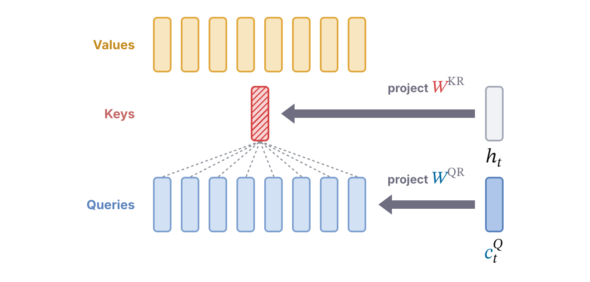

The KV cache for each token becomes:

$$
\text{KV cache per token}=L\times(d_c+d_r)=L\times(512+64)=576\,L
$$

Here \(d_c\) is the latent's 512 dimensions and \(d_r\) is the RoPE branch's 64, so the cache grows only slightly, to about 1/57 of multi-head attention's. As I see it, the design is a trade-off: within the limits of the KV cache, it keeps as much of the model's expressive power as possible.

## Value absorption: weight and sum first, project after

Now let's walk through the full attention computation after decoupling. First, the dot product splits into two parts. The content part contributes \(q_i^C \cdot k_j^C\), and the RoPE part contributes \(q_i^R \cdot k_j^R\). Since \(k_j^R\) has only 64 dimensions and sits in the cache as is, it's computed directly. The two terms are added, divided by the square root of each head's content dimension plus position dimension, \(128 + 64\), and passed through softmax to give the attention weight \(A(i, j)\) of the current token \(i\) on each earlier token \(j\).

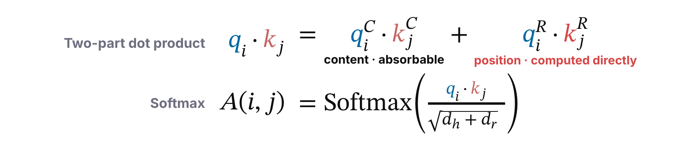

Next comes the weighted sum over the value vectors. The output \(o_i\) uses these weights to add up every earlier token's \(v_j\), written as the sum over all \(j\) of \(A(i, j)\,v_j\). Expand \(v_j\) into \(W^{UV} c_j^{KV}\). Since \(W^{UV}\) doesn't depend on \(j\), it can be pulled all the way out of the sum and put in front. In other words, the weights first mix all the earlier tokens' latents, and only then is the result projected up, once. The weights are already fixed by the softmax at this point, so only linear steps are being rearranged. And because every head's output is then multiplied by the output matrix \(W^O\), and both \(W^O\) and \(W^{UV}\) are fixed weights, the two can be merged into one matrix ahead of time. This is matrix absorption again.

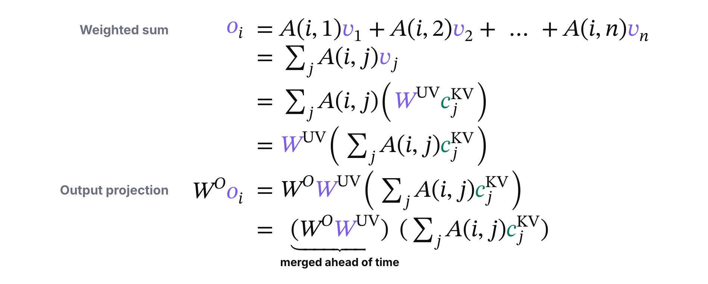

(Merging \(W^O\) and \(W^{UV}\) is an algebraic identity, not a requirement. For DeepSeek-V3, storing the merged matrices would take nearly four times as many weights as keeping the two projections separate, so an implementation can keep them apart and still apply them after the weighted sum.)

Notice the pattern in matrix absorption. MLA has three up-projection matrices. The key's \(W^{UK}\) can be merged ahead of time with the query's \(W^{UQ}\), and the value's \(W^{UV}\) can be merged with the output matrix \(W^O\). So at inference, the up-projections don't need to run on their own, and the cached tokens only ever take part through their 512-dimensional latents \(c_j^{KV}\), plus the shared 64-dimensional RoPE key. The cache is compressed, yet it never has to be decompressed. That's the cleverest part of MLA.

## The full MLA architecture

To finish, let's review MLA's overall architecture. The input vector \(h_t\) goes through three projections at once. On the left, \(W^{DQ}\) projects it down to the query latent \(c_t^Q\). On the right, \(W^{DKV}\) projects it down to the KV latent \(c_t^{KV}\). In the middle, \(W^{KR}\) projects it and RoPE rotates the result, giving \(k_t^R\). From the query latent \(c_t^Q\), two branches go up. The content branch multiplies it by \(W^{UQ}\) to give each head's \(q_t^C\), and the RoPE branch multiplies it by \(W^{QR}\) and rotates the result to give each head's \(q_t^R\). Concatenated, the two parts form each head's full query. From the KV latent \(c_t^{KV}\), \(W^{UK}\) and \(W^{UV}\) give each head's \(k_t^C\) and \(v_t^C\). Each head's \(k_t^C\) is concatenated with the shared \(k_t^R\) in the middle to form its full key, and \(v_t^C\) is its value. Finally, the queries, keys and values all go into multi-head attention to compute the scores.

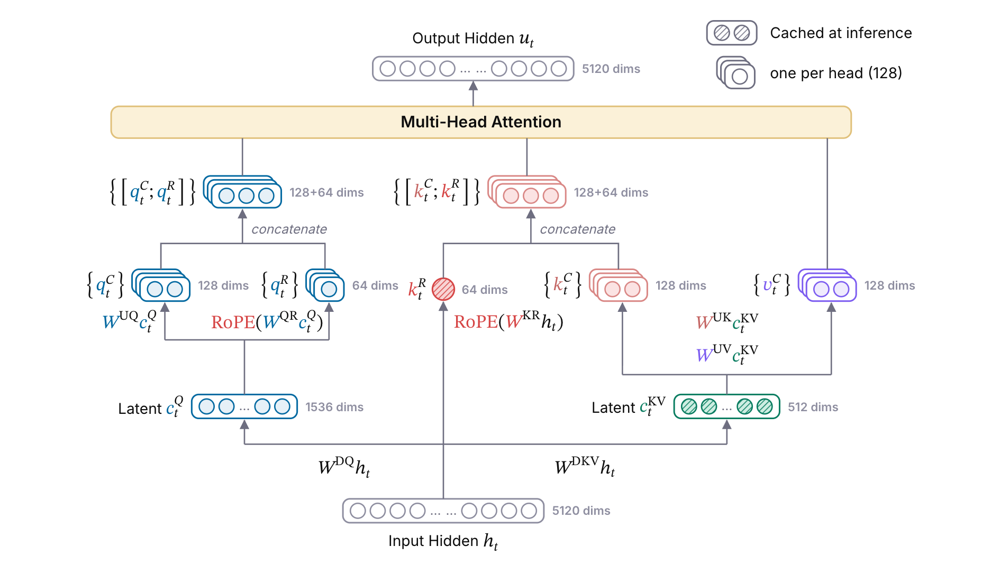

## References

1. DeepSeek-AI (@deepseek_ai). [“DeepSeek-V2: A Strong, Economical, and Efficient Mixture-of-Experts Language Model.”](https://arxiv.org/abs/2405.04434) arXiv, 2024.
