When I was digging into prompt caching in OpenAI's Codex, I noticed something odd: the number of cached tokens always went up in steps of 512. The reason is that before a prompt reaches the model, it gets cut into blocks of a fixed number of tokens, and both prefix matching and the KV cache work one block at a time.

That block-based design has a name: PagedAttention. I only sketched the idea back then. This post walks through how PagedAttention works in vLLM, the open-source inference engine it was built for. (I'm using vLLM because its implementation is public. I'm not claiming OpenAI's servers run the same code.)

## Two kinds of memory fragmentation

To understand PagedAttention, start with the problem it solves. Serving LLMs runs into two problems with how GPU memory gets used.

The first is internal fragmentation. When a request starts, you usually don't know how long its output will be, so the simplest approach is to reserve memory for the maximum context length up front. Most requests never use all of it, and whatever they don't use is wasted.

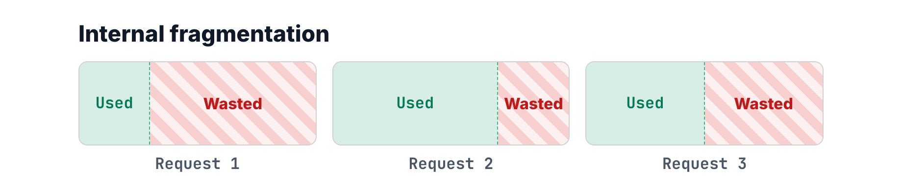

The second is external fragmentation. Some systems allocate memory on demand, in regions of different sizes. But as requests finish and free their memory, the free space breaks up into gaps of different sizes scattered between allocations. You might have 1 GB of free memory in total and still be unable to fit a new request, because no single contiguous 1 GB region exists.

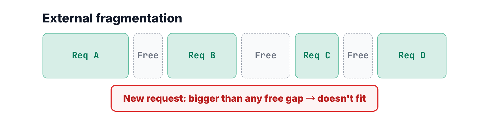

PagedAttention was designed to get rid of both kinds of fragmentation and use GPU memory far more efficiently.

## Borrowing paging from the operating system

Operating systems solved this problem decades ago with paging. A program doesn't need one contiguous chunk of physical memory. Its address space is cut into fixed-size pages, each page goes wherever physical memory has room, and a page table maps the contiguous virtual addresses the program sees onto physical pages scattered anywhere.

PagedAttention brings the same idea to GPU memory, with a block playing the role of a page. In this example the block size is 4 tokens, so prompt 1 and prompt 2 each split into two blocks. The block table in the middle is the page table: it records which physical block each logical block lives in. ABCD sits in physical block 5 and EFGH in physical block 0. The numbers have nothing to do with each other, and blocks that are adjacent logically can sit anywhere physically. Both prompts start with ABCD, so their first blocks point at the same physical block.

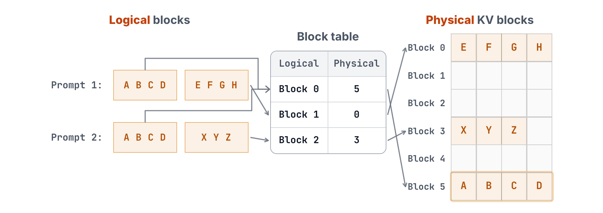

That's the payoff of paging. Every block is the same size, so any free block can go to any request, and there's never a gap that's too small to use. External fragmentation disappears. The only waste left is inside a request's last block, which may not be full. In vLLM a block is typically 16 tokens, so each request wastes fewer than 16 token slots, which is negligible.

## What a physical block looks like

Now let's look at how vLLM manages the physical memory. When vLLM starts up, it cuts the GPU memory set aside for the KV cache into physical blocks all at once. The free blocks are chained into a doubly linked list called `free_block_queue`. When a block is needed, it's taken off this list, and when it's no longer needed, it goes back. Each node in the list is a `KVCacheBlock` object, the metadata for one physical block. It holds four kinds of information:

- `block_id`, the number of the physical block it describes.
- `ref_cnt`, how many requests are currently using the block.
- `_block_hash`, the hash of the prefix stored in the block, which we'll come back to shortly.
- `prev_free_block` and `next_free_block`, the two pointers that chain free blocks into the list.

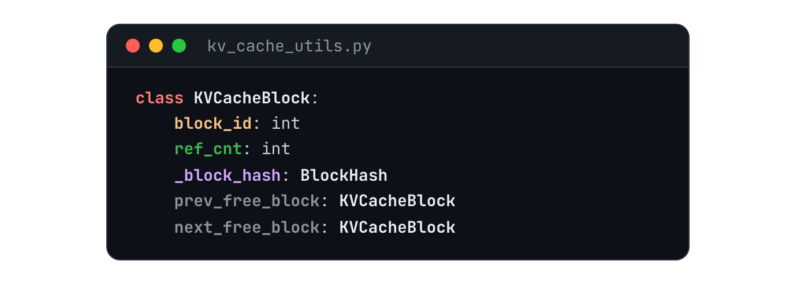

This free list lives in CPU memory and only does the bookkeeping. The actual blocks live in GPU memory. At the top level they're split into L layers: a Transformer has L decoder layers, and each layer needs its own K and V. So a physical block is really a column that runs through every layer. In the diagram, the dashed yellow outline marks `block_id` 2, the same slot in every layer. Across a single layer there are `num_blocks` physical blocks.

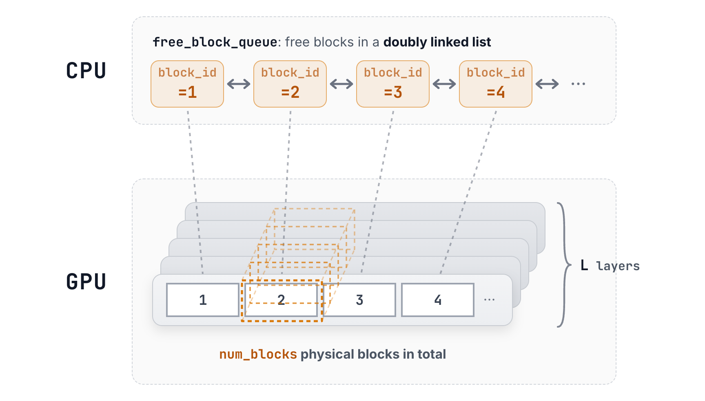

Zoom in on one block and it's a tensor of shape `[2, block_size, num_kv_heads, head_dim]`, where the 2 holds K and V.

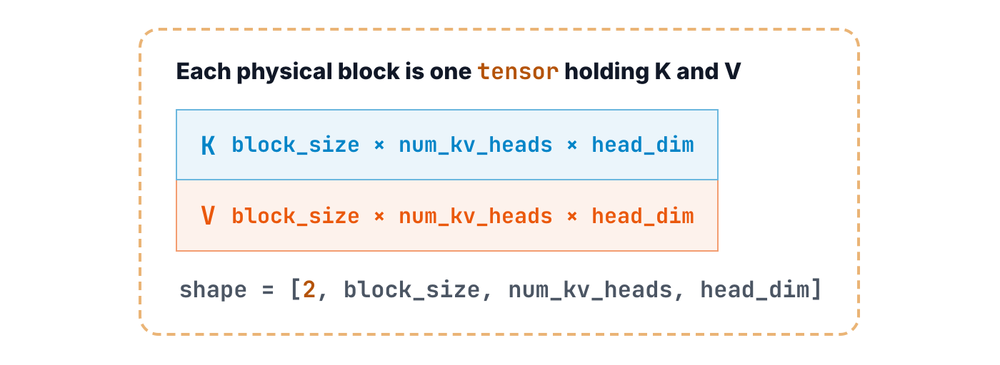

So the total size of the KV cache is all of these numbers multiplied together: L layers, `num_blocks` blocks per layer, `block_size` tokens per block, 2 for K and V, the number of KV heads, the dimension of each head, and finally the bytes per number.

$$
\begin{aligned}
\text{KV cache} = {}&\textcolor{#1d4ed8}{L} \times \textcolor{#b45309}{\mathit{num\_blocks}} \times \mathit{block\_size} \times \textcolor{#b45309}{2}\\
&\times \mathit{num\_kv\_heads} \times \mathit{head\_dim} \times \textcolor{#6b7280}{\text{bytes per element}}
\end{aligned}
$$

This is the same formula from my [previous post on KV cache size](/posts/kv-cache-memory/). The only difference is that the total context length is now written as `num_blocks × block_size`.

## Block hash: telling whether two prefixes match

How is the `_block_hash` in each `KVCacheBlock` computed? With a chained hash. The formula is short: the hash of block n is the hash of block n−1's hash together with all the tokens in block n.

$$
\textcolor{#6d28d9}{\mathrm{hash}(\text{Block } n)} = \mathrm{hash}\big(\textcolor{#6d28d9}{\mathrm{hash}(\text{Block } n-1)},\ \textcolor{#b45309}{\mathrm{tokens}(n)}\big)
$$

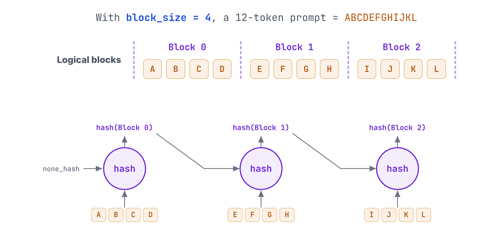

Because the hash is chained, block n's hash already folds in every token from the first block through block n. So when two blocks have the same hash, we know that block and everything before it are identical. A matching prefix is exactly what prompt caching needs before it can reuse anything.

## Two lookup structures

PagedAttention in vLLM relies on two more data structures. The first is `BlockHashToBlockMap`, a map from block hash to `KVCacheBlock`. There's a single global copy shared by all requests. When a new request arrives, vLLM looks up each of its block hashes in this map. A hit means some earlier request already computed that prefix, and the map says where in GPU memory the result is stored.

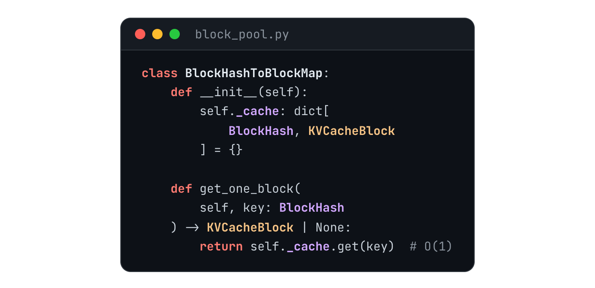

The second is the block table, called `req_to_blocks` in the code. For each request it keeps the list of KVCacheBlocks that hold the request's KV cache, in order. This list is exactly the logical-to-physical mapping from the paging picture earlier.

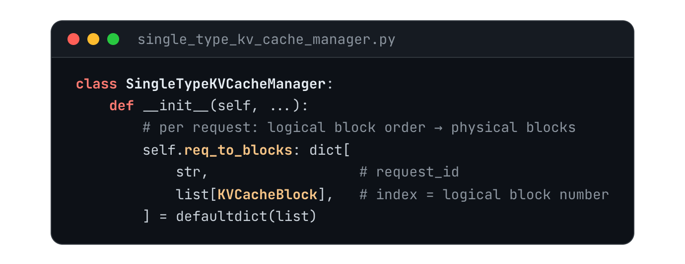

That's every concept PagedAttention needs. Now let's follow a complete example.

## Walking through two requests

At time 0, the first request arrives. Its prompt is 12 tokens, ABCD through IJKL, which splits into 3 logical blocks at a block size of 4. The three block hashes come out as 0xABCD, 0xABGH and 0xABKL. (Since each hash covers the whole prefix, I'm labeling it with the first two and last two tokens of that prefix to keep it readable. Real hashes look nothing like this.) `BlockHashToBlockMap` starts out empty, so all three lookups miss. Every logical block needs a new physical block, so vLLM takes blocks 0, 1 and 2 off the front of `free_block_queue` and records them in `req_to_blocks[0]`. On the GPU side, each of the three blocks gets `ref_cnt` 1, meaning one request is using it, and records its own hash. Since nothing hit, all three blocks have to go through prefill, so they're all marked COMPUTE.

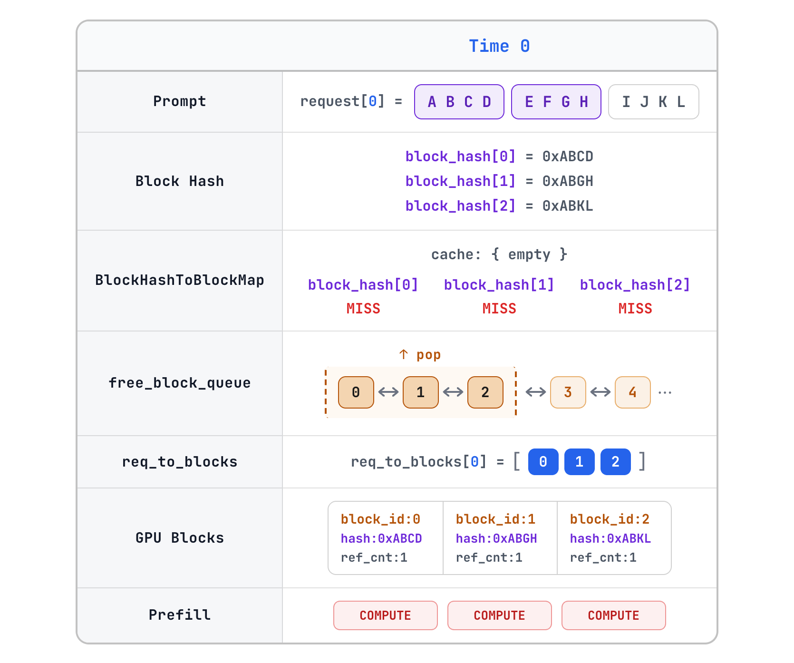

At time 1, the second request arrives. Its first eight tokens are identical to the first request's, followed by XYZ. Its first two block hashes therefore come out as 0xABCD and 0xABGH, matching the first request exactly. The third block holds only three tokens, and there's a rule here: only full blocks get a hash. This block is the tail of the prompt and will soon be filled by tokens from decode, so its hash is computed once it's full.

Looking up `BlockHashToBlockMap`, the first two hashes are already there. Those two blocks don't need new physical blocks or copies, because their KV cache is already sitting in physical blocks 0 and 1. Only the third block needs a new physical block, so vLLM takes block 3 off the queue, and `req_to_blocks[1]` becomes blocks 0, 1 and 3. The `ref_cnt` of blocks 0 and 1 goes from 1 to 2, meaning two requests now share that memory. Block 3 isn't full, so its hash is empty and its `ref_cnt` is 1. It's also the only block that needs computing. The results for the first two blocks are already in memory, so they're skipped.

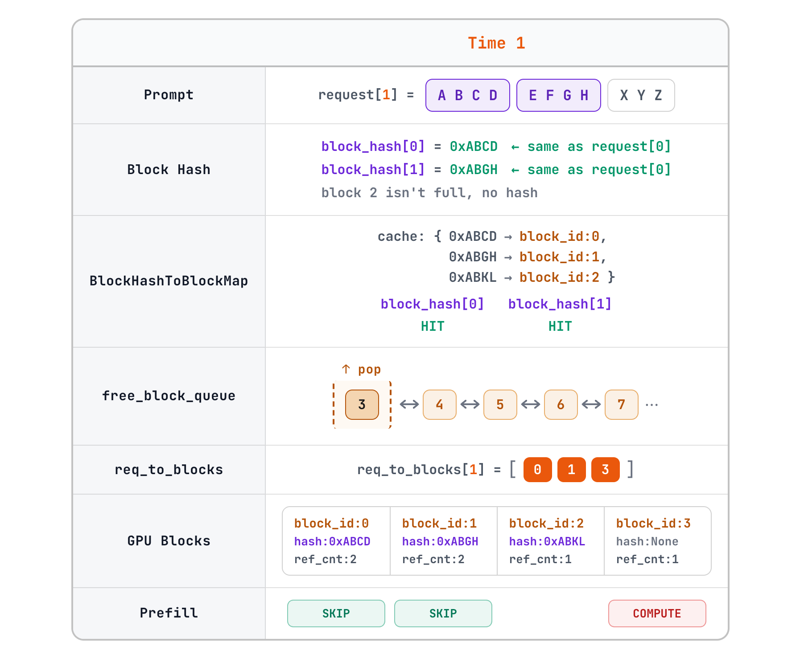

That's the core rule for new requests. When a block's prefix hash hits, the block is neither copied nor recomputed. vLLM finds the physical block, adds 1 to its `ref_cnt` and reads the result directly. Only blocks freshly allocated from the free queue need actual computation.

## When a request finishes

What happens when a request is done? At time 2, the first request finishes. Its three blocks, 0, 1 and 2, each have their `ref_cnt` reduced by 1. Blocks 0 and 1 are still in use by the second request, so their counts drop to 1 and they stay put. Block 2 drops to 0, meaning no one is using it, so it goes back into `free_block_queue`.

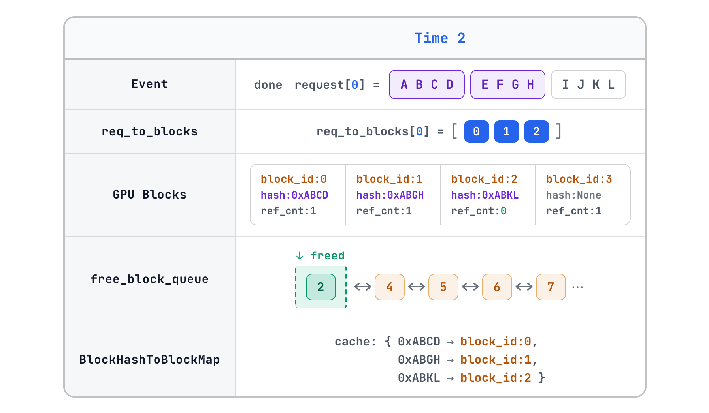

Notice that `BlockHashToBlockMap` hasn't changed at all. The entry mapping 0xABKL to block 2 is still there. Block 2 can now be handed to a future request, but its computed KV data is still sitting in GPU memory. If some future request produces a hash that matches what's in block 2, that result shouldn't go to waste. It can be reused instead of recomputed.

At time 3, the second request finishes too. The `ref_cnt` of blocks 0, 1 and 3 all drop to zero, and all three go back into the free queue. The hash map still has the same three entries, none deleted.

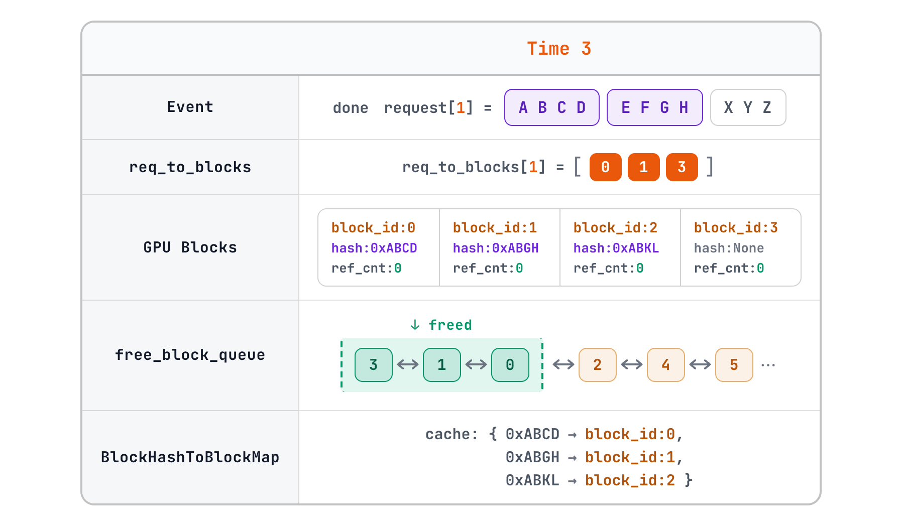

(The diagrams simplify the queue order. In vLLM, freed blocks are appended to the end of the queue and new blocks are taken from the front, so the blocks that have sat unused the longest are the first to be reused.)

So when a request ends, returning a block to the free queue doesn't mean throwing it away. The KV data in those four physical blocks is still there, and so are the hash map entries. The blocks are only marked as unused and available. Until one of them is actually handed out again, any request with the same prefix can still hit it.

## Picking freed blocks back up

At time 4, a third request arrives, and it's an interesting one. Its first eight tokens are again A through H, the same as the first two requests, followed by four Ps and four Qs, for four blocks in total. The first two hashes are again 0xABCD and 0xABGH, and the last two are new: 0xABPP and 0xABQQ. The lookup gives two hits and two misses. The hit blocks, 0 and 1, are sitting in the free queue with `ref_cnt` 0. But as we just saw, their results are still valid and still in GPU memory, so vLLM pulls them straight out of the queue and sets their `ref_cnt` from 0 back to 1. None of their KV cache needs recomputing, so prefill skips the first two blocks.

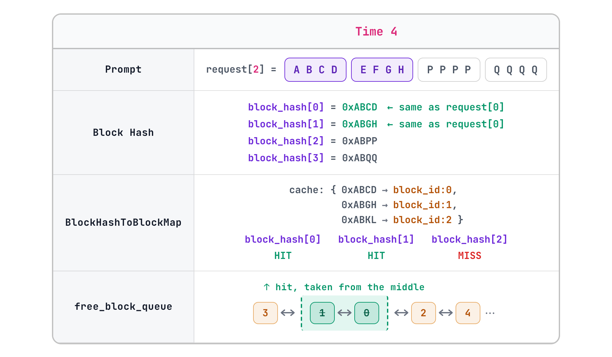

The last two blocks missed, so they need new blocks from the free queue: physical blocks 3 and 2, taken from the front. And here's the interesting part. Block 2 still holds the data for hash 0xABKL. Now that block is about to store the four Qs, its old data will be overwritten, so the 0xABKL entry in the hash map is no longer valid. Only at this moment is it evicted, replaced by 0xABQQ. Eviction isn't a periodic cleanup, and it isn't a cache expiring. A hash entry becomes invalid only when its physical block is handed out again and the old contents are about to be overwritten. The rest follows naturally: `req_to_blocks[2]` is blocks 0, 1, 3 and 2, and only the last two need computing.

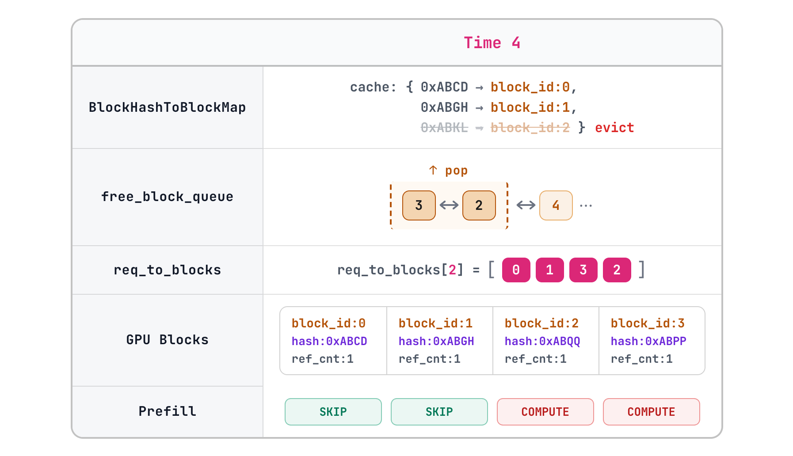

## Wrapping up

To sum up, PagedAttention cuts the KV cache into blocks that can be paged, mapped and shared. Physical blocks in GPU memory are small fixed-size slots for KV tensors. The hash map lets different requests find the same block by its content. `ref_cnt` keeps a shared block from being freed while someone still uses it. And the free queue lets blocks from finished requests be picked back up by the next request. Together, these make far better use of GPU memory when serving LLMs.

(The example uses a block size of 4, a tiny pool of blocks and short labels like 0xABCD so everything fits in a diagram. A real scheduler also handles preemption, swapping and more, which this post leaves out.)

## References

1. Kwon et al. (@woosuk_k). [“Efficient Memory Management for Large Language Model Serving with PagedAttention.”](https://arxiv.org/abs/2309.06180) SOSP 2023.
2. vLLM (@vllm_project). [“Automatic Prefix Caching.”](https://docs.vllm.ai/en/latest/design/prefix_caching/) vLLM documentation.
3. vLLM (@vllm_project). [“Paged Attention.”](https://docs.vllm.ai/en/latest/design/paged_attention/) vLLM documentation.
4. Aleksa Gordić (@gordic_aleksa). [“Inside vLLM: Anatomy of a High-Throughput LLM Inference System.”](https://www.aleksagordic.com/blog/vllm) 2025.
5. Sankalp (@dejavucoder). [“How prompt caching works: Paged Attention and Automatic Prefix Caching plus practical tips.”](https://sankalp.bearblog.dev/how-prompt-caching-works/) 2025.
