"Dog bites man" and "man bites dog" contain exactly the same words. Swap two of them and the meaning flips.

Left to itself, a Transformer can't tell these two sentences apart. Attention, the mechanism at the heart of the model, never looks at where a token sits. As far as attention is concerned, a sentence is a bag of tokens, not a sequence.

This post walks through why Transformers need positional encoding, and how the sine-and-cosine scheme from the original paper captures position so neatly.

## What attention sees without positions

Let's start with plain attention and see what goes wrong when it has no position information. I won't re-derive attention here. All we need is the formula:

$$
\text{Attention}(Q,K,V)=\text{softmax}\!\left(\frac{QK^{\top}}{\sqrt{d_k}}\right)V
$$

Multiply \(Q\) by \(K\) transposed, scale by \(\sqrt{d_k}\), apply softmax, and use the resulting weights to mix the value vectors in \(V\).

Now take two sentences:

- "Alice hits Bob. Who's hurt?"
- "Bob hits Alice. Who's hurt?"

Suppose the model has just read the last token, "hurt", and is about to predict the next one. Here's what happens in that decoding step.

In the first sentence, the query vector for "hurt" is dotted with the key vector of every earlier token. That produces a row of scores: \(q_{\text{hurt}} \cdot k_{\text{Alice}}\), \(q_{\text{hurt}} \cdot k_{\text{hits}}\), \(q_{\text{hurt}} \cdot k_{\text{Bob}}\), and so on. Softmax turns those scores into weights, and the output is a weighted sum of the tokens' value vectors.

In the second sentence, Alice and Bob trade places, so the scores come out as \(q_{\text{hurt}} \cdot k_{\text{Bob}}\), \(q_{\text{hurt}} \cdot k_{\text{hits}}\), \(q_{\text{hurt}} \cdot k_{\text{Alice}}\). It's the same set of terms in a different order, and the value vectors get reshuffled in exactly the same way.

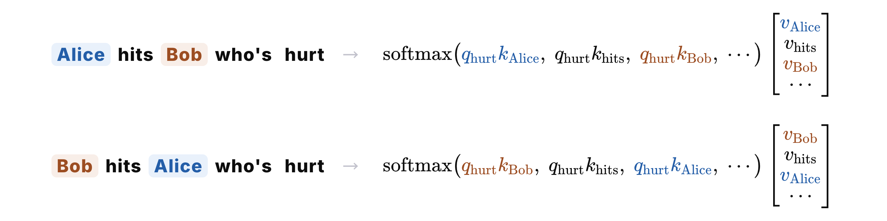

That's the whole problem. A value vector's weight depends only on its own score, not on where it shows up in the list. So every value vector gets the same weight in both sentences, and since addition doesn't care about order, both sentences produce exactly the same output vector.

Generation is autoregressive, so the same output means the model continues both sentences the same way. It has no way to tell who's hurt. On its own, attention is blind to word order.

## Two obvious fixes: integers and fractions

The most direct fix is to add each token's position number to its embedding.

Say the sequence is 64 tokens long and "Bob" is token 24. Every token is a \(d\)-dimensional embedding vector.

The naive version adds 24 to every dimension of Bob's embedding. It's simple, but the problem is obvious. Embedding values are small numbers like the ones below, and position numbers are one or two orders of magnitude larger. Add the two together and the position drowns out whatever the embedding was saying about the word.

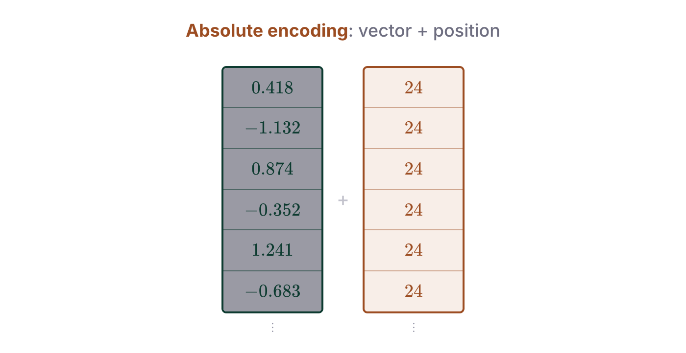

So let's scale it down. Divide the position by the sequence length \(L\), and every value lands between 0 and 1.

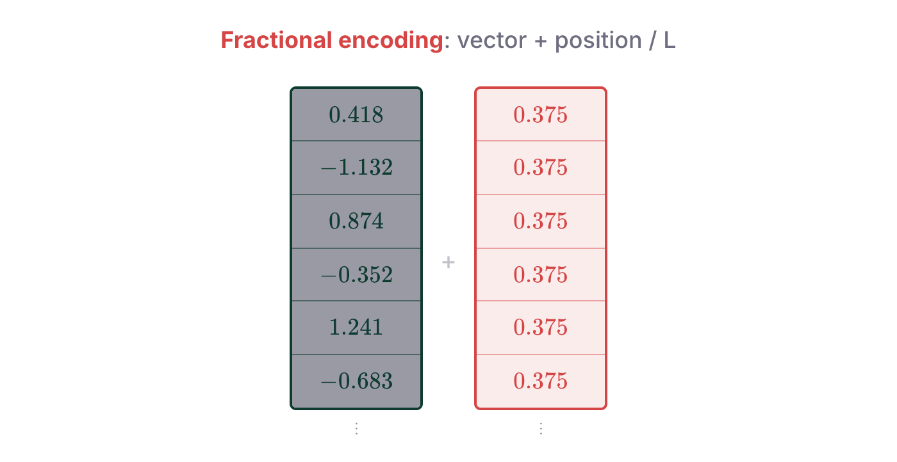

Now the position no longer drowns out the embedding, but we've traded one problem for another: the encoding depends on how long the sequence is. Token 24 gets 0.375 in a 64-token sequence but 0.024 in a 1,000-token one.

$$
\begin{aligned}
L = 64: &\quad \frac{24}{64} = {\color{#0a7d61}0.375} \\[4pt]
L = 1000: &\quad \frac{24}{1000} = {\color{#d64545}0.024}
\end{aligned}
$$

The same position gets a different code every time the length changes, so the model can never learn a stable meaning for any particular value.

## Binary: bounded and length-independent, but discontinuous

Let's try again. Another way to write down a position is in binary.

24 in binary is 011000. Every digit is either 0 or 1, so the values stay in a fixed range. And position 24 is always 011000, however long the sequence is. Add those six bits to six dimensions of the embedding, one bit each, and you have a binary positional encoding.

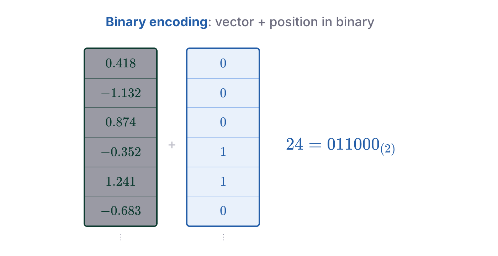

It helps to picture each bit as a square wave. The horizontal axis is position, from 0 to 63, and each row tracks one bit:

- The top row is the lowest bit. It flips at every position.
- The next row flips every 2 positions.
- The rows below flip every 4, 8, 16 and 32 positions.

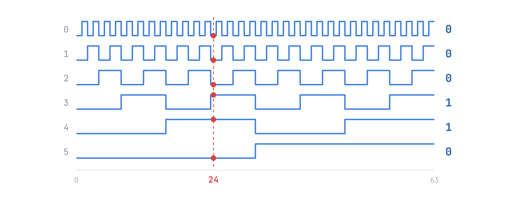

To read the code for a position, read down its column. For 24, going from the lowest bit to the highest, you get 0, 0, 0, 1, 1, 0. Position 0 is all zeros and position 63 is all ones.

Binary gets a lot right, but it has one big flaw: it changes in jumps. Look at what happens between 23 and 24:

$$
\begin{aligned}
23 &= 0\,1\,0\,1\,1\,1_{(2)} \\[2pt]
24 &= 0\,1\,{\color{#d64545}\mathbf{1\,0\,0\,0}}_{(2)}
\end{aligned}
$$

One step forward flips four bits at once. That's bad news for a neural network. Networks learn by gradient descent, and gradient descent works best on smooth, continuous functions: if the position changes a little, the encoding should change a little too. That's what lets the gradient tell the model which way things are moving.

## Sinusoidal encoding: smoothing out the steps

This is where "Attention Is All You Need", the paper that introduced the Transformer, comes in. Its answer is sinusoidal positional encoding.

The idea is to split the encoding vector's \(d\) dimensions into pairs. In each pair, the even dimension gets a sine and the odd dimension gets a cosine:

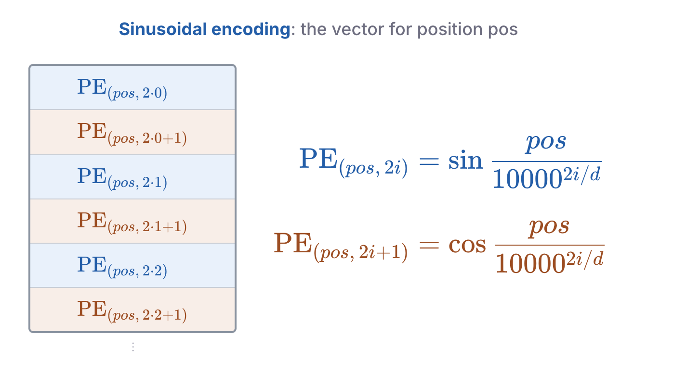

Both lines share the same argument. One takes its sine and the other its cosine. Here \(pos\) is the position, \(i\) is the index of the pair, \(d\) is the size of the vector, and 10000 is a fixed constant.

If the formula looks arbitrary, don't worry. We'll come at it from a few angles until the design makes sense.

First, let's plot it. Notice how much it resembles the square waves from before. The first pair changes fastest: nudge the position and its values already move. Each pair after that changes more slowly.

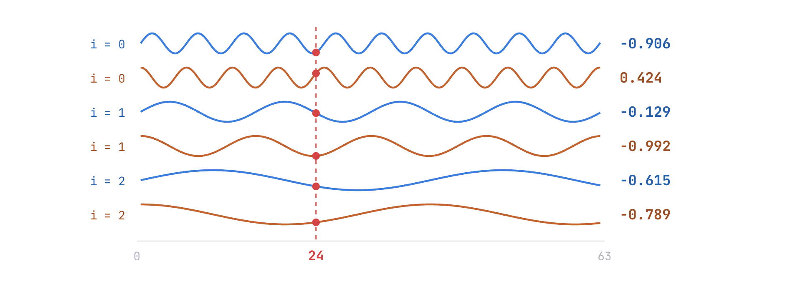

The difference is that the square waves have become smooth curves. Where binary jumped, these change continuously.

It ticks the other boxes too:

- Bounded: sine and cosine always stay between \(-1\) and \(1\).
- Length-independent: the formula only involves \(pos\), \(i\) and \(d\). The sequence length \(L\) appears nowhere, so a position's encoding depends only on the position itself.

Every requirement we've collected so far is met.

## Wavelengths: a geometric sequence from 2π to 2π·10000

Now for a different angle: the wavelength of each sine wave.

A quick refresher. The basic sine function, \(y = \sin x\) (blue), has a wavelength of \(2\pi\), meaning the curve repeats every \(2\pi\).

What about \(y = \sin(x/2)\) (orange)? Its wavelength is \(4\pi\). Because \(x\) is divided by 2, it has to travel twice as far to complete one cycle, so the wave is stretched to twice the length.

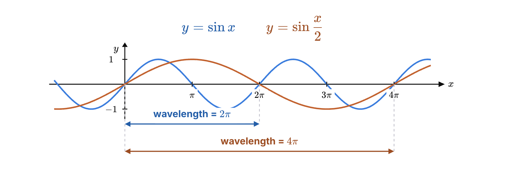

The general rule: dividing \(x\) by \(a\) stretches the wave by a factor of \(a\).

$$
y = \sin\frac{x}{a} \quad\Longrightarrow\quad \text{wavelength} = 2\pi \cdot a
$$

In the positional encoding, the divisor is \(10000^{2i/d}\), so the wavelength of pair \(i\) is:

$$
y = \sin\frac{x}{10000^{2i/d}} \quad\Longrightarrow\quad \text{wavelength} = 2\pi \cdot 10000^{2i/d}
$$

Let's plug in \(d = 8\), which gives four pairs.

- For \(i = 0\), the exponent \(2i/d\) is 0, and \(10000^0 = 1\). The wavelength is \(2\pi\), so this pair repeats roughly every 6 positions.
- For \(i = 1\), the exponent is 0.25, and \(10000^{0.25}\) is exactly 10. The wavelength is \(20\pi\).
- The pattern continues: each pair's wavelength is 10 times the previous one.

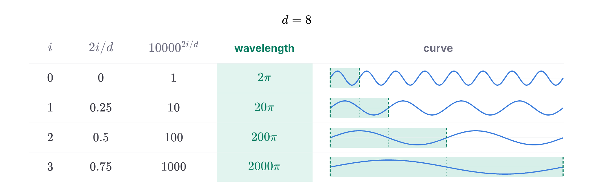

(The curves on the right show the pattern, not the true scale. Each row is drawn twice as wide as the one above. At the real 10× ratio, the bottom rows would look flat.)

In general, the wavelengths form a geometric sequence that starts at \(2\pi\) and climbs toward \(2\pi \cdot 10000\) for the last pair. You can read a wavelength as the number of positions before that pair's values repeat.

This is the same structure as binary. In binary, the bits flip every 1, 2, 4, 8 positions, doubling each time. In the sinusoidal encoding, the ratio between neighbors is set by 10000 and \(d\) instead of being 2. Either way, low dimensions change fast and high dimensions change slowly.

Wavelengths also explain the choice of 10000. The longest wavelength is close to

$$
2\pi \cdot 10000 \approx 62{,}832 \ \text{tokens}
$$

So the slowest pair doesn't repeat for roughly 60,000 positions, which means any sequence shorter than that gets a distinct code at every position. That's plenty for typical context lengths. You could use a bigger base, like 100,000, but there's little reason to: when processing text, a token rarely needs context from 100,000 tokens back.

## Each sin/cos pair is a clock hand

One question is left: why does the encoding come in sine/cosine pairs?

Recall from high-school trig that the cosine and sine of the same angle are the coordinates of a point on the unit circle.

So let's rewrite the formula. Define \(\omega_i\) as the reciprocal of the divisor, which physicists call the angular frequency:

$$
\omega_i = \frac{1}{10000^{2i/d}}
$$

Pair \(i\) then becomes \(\sin(\omega_i \cdot pos)\) and \(\cos(\omega_i \cdot pos)\), and \(\omega_i \cdot pos\) is simply an angle.

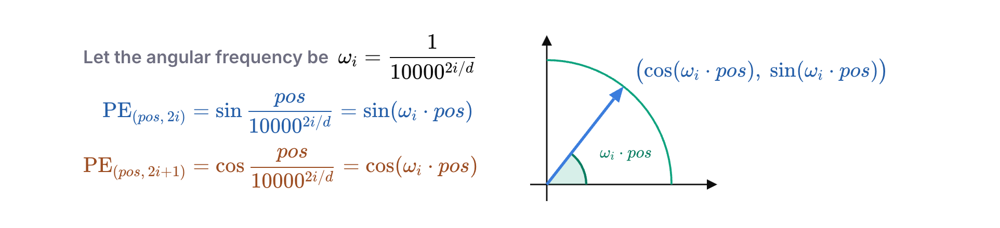

Seen this way, the encoding becomes intuitive: each sine/cosine pair is a hand on a clock. Every time \(pos\) goes up by 1, the hand rotates counterclockwise by \(\omega_i\).

We saw earlier that \(10000^{2i/d}\) grows with \(i\). Since \(\omega_i\) is its reciprocal, it shrinks as \(i\) grows, so higher pairs turn more slowly.

The four circles below show the four hands at the same \(pos\). The low pairs spin quickly, and each pair up turns more slowly. At normal speed you can barely see the bottom two move, but speed things up and they start turning:

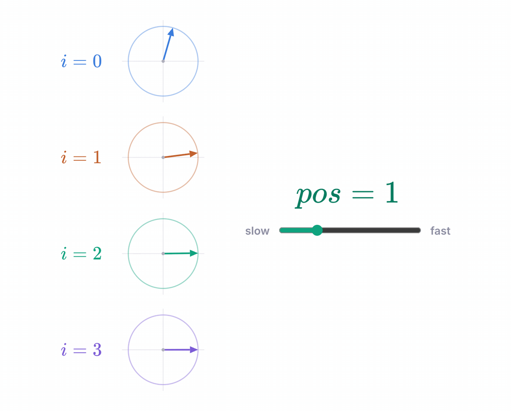

Sound familiar? It's a clock face with a second hand, a minute hand and an hour hand. No single hand tells you the exact time, but together they pin down one unique moment.

Positional encoding works the same way. Each pair of dimensions is a hand, and the position \(pos\) is the time. The wavelengths from the previous section get a new meaning too: a pair's wavelength is how many positions its hand needs to go around once.

## References

[1] Christopher Fleetwood. [“You could have designed state of the art positional encoding.”](https://huggingface.co/blog/zh/designing-positional-encoding) Hugging Face Blog, 2024. (Chinese translation)

[2] Naoki Shibuya. [“Transformer’s Positional Encoding.”](https://naokishibuya.github.io/blog/2021-10-31-transformers-positional-encoding/) 2021.

[3] Vaswani et al. [“Attention Is All You Need.”](https://arxiv.org/abs/1706.03762) NeurIPS 2017.
