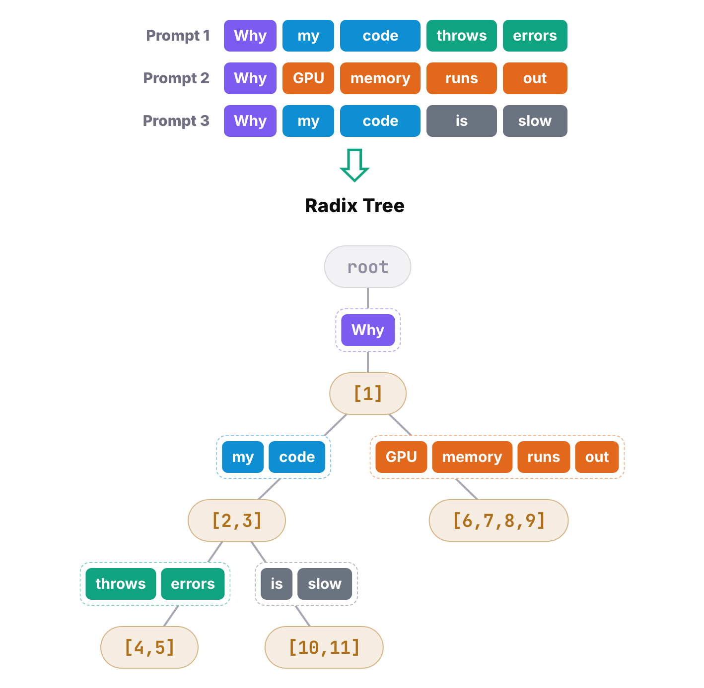
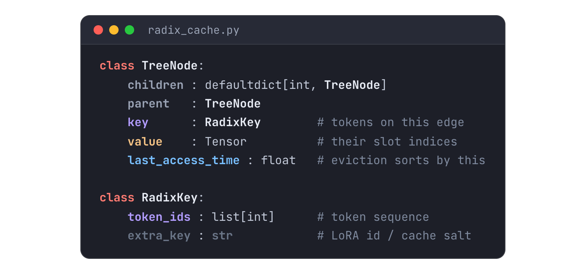
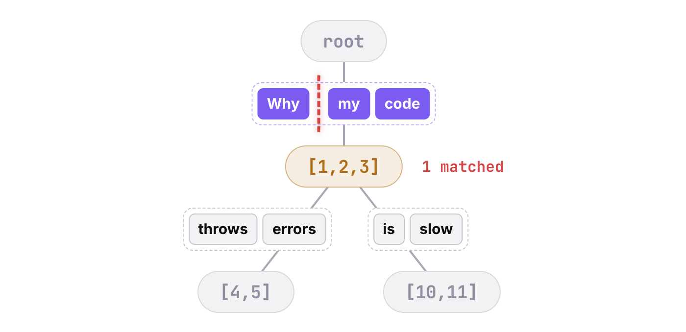
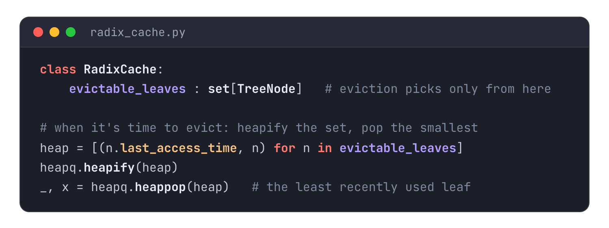

In an [earlier post](/posts/paged-attention/) I covered vLLM's PagedAttention and how it manages the KV cache in fixed-size blocks of GPU memory. Plenty of readers asked about SGLang next, so this post covers SGLang's core attention mechanism, RadixAttention.

## The radix tree: three prompts, one tree

SGLang's key idea is a data structure called a radix tree. It finds the prefixes that different requests have in common quickly, and reuses the KV cache earlier requests already computed for them, so that work isn't done twice. Take three prompts: "Why my code throws errors", "Why GPU memory runs out" and "Why my code is slow". Put them into a radix tree and you get the shape below. Everything starts from one shared root, identical prefixes are merged, and the tree branches where the prompts start to differ. Each edge holds a run of tokens, and a prompt is what you get by concatenating the tokens on every edge along a path from the root.

"Why my code throws errors", for example, is the path from the root that keeps to the left all the way down to a leaf. Each node also stores a list that says where in GPU memory the KV cache for the tokens on its incoming edge lives: the indices of the physical slots holding it. The column on the right shows which token sits in each slot.

![The same tree next to the 11 physical GPU slots: node [1] points to slot 1, [6,7,8,9] to slots 6 to 9, and [10,11] to slots 10 and 11](t1_slots.png)

(To keep the figure readable, leader lines are drawn for three of the nodes. The numbers inside every node give the full mapping.)

The radix tree on the left organizes the prompt prefixes so they can be reused, and the slot indices in its nodes tie it one-to-one to the real KV cache in GPU memory on the right. As a result, a shared prefix is computed and cached only once, and every later request with that prefix reuses its KV cache instead of computing it again.

## The physical KV pool: slots are fixed cells in GPU memory

Now for the physical slots themselves. When SGLang starts, it carves GPU memory into two arrays in one go, `k_buffer` and `v_buffer`. At the top level each array is split into L layers, because the Transformer has L decoder layers. Each layer is then cut into physical slots, and each slot holds one token's K and V for that layer. So a physical slot is a column that runs through every layer: slot 4, the one inside the amber dashed outline, is the same position sliced out of every layer. Along one layer there are `num_tokens` slots, the capacity of the whole pool in tokens.

![free_pages above the layered k_buffer / v_buffer: alloc(2) hands out slots 1 and 2, free([4,5]) returns 4 and 5, and slot 4 is outlined through all L layers](t2_pool.png)

The indices of every free slot live in a tensor called `free_pages`. At startup it holds 1 through `num_tokens`. Two operations work on it. `alloc(n)` takes n free slots from the front of the queue, so the `alloc(2)` in the figure takes slots 1 and 2. `free()` takes a list of slot indices and returns them to the pool, appended at the back, which is why the indices a later `alloc()` hands out aren't guaranteed to be contiguous. The detail that matters most is that `free_pages` is itself a tensor on the GPU. Indices taken from it can be used directly to read and write `k_buffer` and `v_buffer`, with no copy between CPU and GPU.

Zoom into a single slot and it is a tensor of shape `num_heads × head_dim`, the number of attention heads times the size of each head. Put that together with the layout above, and `k_buffer` and `v_buffer` each have the shape `[L, num_tokens, num_heads, head_dim]`.

![One slot in one layer: a K tensor and a V tensor, each num_heads × head_dim, so k_buffer.shape = [L, num_tokens, num_heads, head_dim]](t2_slot.png)

## TreeNode: what a node actually holds

Back to the radix tree and how it's implemented. The central data structure is `TreeNode`, and it has a few important fields. `children` is a map that holds all of the node's child nodes. `parent` points to the parent node. More important is `key`, of type `RadixKey`, which holds the tokens on the edge from the parent to this node. As the definition of `RadixKey` below shows, it is essentially a list of token IDs. (Its `extra_key` field keeps, for example, requests on different LoRA adapters from sharing a cache entry.)

The `value` that goes with the key is a tensor: the indices of the physical slots where those tokens' KV cache ended up. Finally, `last_access_time` records when the node was last touched. When GPU memory gets tight, this timestamp decides which nodes are evicted to make room.

One detail about `children`. It's a map, so what are its keys and values? The values are, of course, the child nodes. The key for each child is the first token on the edge from the parent to that child. Why only one token rather than the whole edge? Because children only exist where the prompts diverge: their edges have no common prefix, so they must already differ at the very first token. That one token is enough to tell every child apart.

Here is the "my code" node from the tree, zoomed in to show the value of each field right now. `children` holds two entries: "throws", the first token of "throws errors", points to node [4,5], and "is", the first token of "is slow", points to [10,11]. `parent` points to [1]. `key` is every token on the edge from the parent, so it's "my" and "code". `value` is `tensor([2, 3])`. It follows that a node's key and value always have the same length, because their elements correspond one to one.

![The "my code" node zoomed in: children maps throws → [4,5] and is → [10,11], parent is [1], key is [my, code], value is tensor([2, 3])](t3_node.png)

## Inserting a node: walk the tree, split where the match stops

The core operation on a radix tree is inserting a node. Say we want to add a new prompt: "Why GPU memory runs out". First, walk down from the root, comparing the prompt with each edge in turn. Wherever it matches, keep going. Where it stops matching, you've found the branch point. Here the very first edge from the root doesn't match all the way: only its first token, "Why", does.

Second, split the node. At the point where the match stopped, pull the longest common prefix out and cut the existing edge there. One edge and one node become a common-prefix node plus a node for the rest of the branch, and the common prefix becomes the parent. Here "Why" is split off into a new common-prefix node, [1], and the old node becomes its child.

![Step 2: "Why" is split off as the new common-prefix node [1]; the old node keeps "my code" and [2,3]](t4_split.png)

Third, under the common-prefix node, create a new child node and edge for the part of the new prompt that didn't match, and allocate that many physical KV slots for it. The tokens after "Why", "GPU memory runs out", didn't match anything, so they get a new child node, with slots [6,7,8,9].

![Step 3: "GPU memory runs out" is inserted as a new child of [1], with slots [6,7,8,9]; the tree now matches the one at the top of the post](t4_insert.png)

(The starting tree here is for illustration. In the walkthrough below the same final tree is reached in a different order.)

Notice what steps two and three change: only the slot indices stored in `TreeNode`s. The KV cache itself never moves in GPU memory. Splitting and inserting rearrange the indices that point at the KV cache, while the actual KV data stays put in physical memory the whole time. Compare this with [PagedAttention](/posts/paged-attention/), which finds the longest common prefix by computing a hash for each block and looking it up in a table. RadixAttention finds it by walking the tree to the node where the longest common prefix ends. They're two different ways to answer the same question, and both are neat.

## Evicting a node: pop the oldest leaf off a heap

Besides inserting, we also need to evict nodes when physical memory runs out. The key data structure here is `evictable_leaves`, a set of `TreeNode`s that tracks the leaves of the radix tree that can currently be evicted. When it's time to evict, these leaves are arranged into a min-heap ordered by `last_access_time`. Each eviction pops the node at the top of the heap, the one that hasn't been accessed for the longest time, deletes it and frees the physical slots it held. Deleting a leaf can turn its parent into a leaf, so `evictable_leaves` and the heap are updated to include it, and the process repeats until enough physical memory has been freed.

In this tree, `evictable_leaves` holds three leaves, circled in red. Their `last_access_time` values are time 2, time 2 and time 1. So when a node has to go, the one the min-heap gives us is the leaf for "GPU memory runs out", and its four physical slots, 6, 7, 8 and 9, are freed.

![The tree with its three evictable leaves circled: [4,5] and [10,11] at time 2, and [6,7,8,9] at time 1, the oldest](t5_evict_tree.png)

## The full walkthrough: three requests, every structure updated

That's every piece of the radix tree. Now let's run one complete example to see how RadixAttention behaves. To keep it small, assume the pool has only 11 slots, every request generates a single token and then finishes, and the requests arrive one after another.

At time 0, request 0, "Why my code throws errors", arrives. The tree is still empty, so the walk stops at the root, and the hit value, the set of cached slots the request can reuse, is empty. None of the five tokens can be skipped, and all of them go through the forward pass. So we `alloc(5)` from `free_pages`, which hands out slots 1 to 5, and after the forward pass those slots hold the KV cache for "Why my code throws errors". Once that's done, the whole prompt is inserted into the tree as a single edge of five tokens. Its node's value is [1,2,3,4,5], and its `last_access_time` is time 0.

![Time 0: the tree is empty, so all 5 tokens are computed; alloc(5) takes slots 1 to 5, and the whole prompt is inserted as one node [1,2,3,4,5]](t6_time0.png)

At time 1, request 1, "Why GPU memory runs out", arrives. Walking the tree with this prompt, the first edge only matches as far as its first token, "Why". So the node is split here, and "Why" becomes the common prefix. Its slot, [1], is a hit and doesn't need to be recomputed. The remaining four tokens, "GPU memory runs out", do need computing, so `alloc(4)` gives us slots [6,7,8,9]. Once the Transformer has computed their K and V, the remaining tokens and their slots are inserted into the tree, as shown in the dashed outline. Notice that both leaves now have a `last_access_time` of time 1: the left leaf is also new, because it was just created by the split.

![Time 1: the match splits off "Why" [1]; alloc(4) takes slots 6 to 9, and "GPU memory runs out" is inserted as [6,7,8,9]](t6_time1.png)

At time 2, request 2, "Why my code is slow", arrives. The walk starts at the root again. "Why" matches the first edge, which brings us to the first node. The next token is "my", which is in the `children` map, so we go left. But that edge doesn't match all the way: only "my" and "code" do. So the node is split again, and those two tokens become a common node. The slot values collected along the way are [1,2,3]. That KV cache doesn't need recomputing, and only "is slow" has to be computed. Two more slots, 10 and 11, come from `free_pages`, and at this point the free slots have all been handed out. Finally the computed slots and tokens are inserted into the radix tree, giving the node in the dashed outline. Again, the newly inserted node and its sibling on the left were both created by this request, so both have a `last_access_time` of time 2.

![Time 2: the match splits "my code" [2,3] off from "throws errors" [4,5]; alloc(2) takes slots 10 and 11 and the pool is empty; "is slow" is inserted as [10,11]](t6_time2.png)

## Eviction kicks in: out of slots, so a leaf goes

At time 3 something interesting happens. A new request, "Why my code won't compile", comes in. The first step is still the walk. "Why" matches completely, so we go down; "my code" also matches completely, so we keep going left. Below that, the next token, "won't", isn't in the `children` map. This time there's no need to split anything: the walk lands exactly on the node where the longest common prefix ends. The collected slots, [1, 2, 3], can be skipped, and only 2 tokens need computing.

But remember that after the last request, `free_pages` had no free slots left, so this request triggers an eviction. The path the request just matched, circled in green, is locked first, so the eviction can't take the prefix this request is about to use. By the min-heap rule, the least recently accessed node in `evictable_leaves` is the one on the right, "GPU memory runs out", with a `last_access_time` of time 1. It's removed from the tree, and its four slots, 6, 7, 8 and 9, are returned to `free_pages`. Eviction works a whole node at a time, so four slots come back even though this request needs only two.

![Time 3, eviction: the match lands on "my code" [2,3] without a split; the oldest leaf, "GPU memory runs out" [6,7,8,9], is removed and free() returns slots 6 to 9](t7_evict.png)

Now there's room to compute. Just as before, the remaining two tokens, "won't" and "compile", get two slots, 6 and 7. They're computed and inserted into the radix tree. Slots 8 and 9 are struck through in the slot row: `free()` only returns their numbers to the pool, and the old KV for "runs out" stays in them until a later `alloc()` overwrites it.

![Time 3, after: alloc(2) hands slots 6 and 7 to "won't compile", which is inserted under "my code" as [6,7]](t7_after.png)

## Summary: all the savings come from the prefix match

Back to where we started. RadixAttention puts the prefixes of every request into a single tree, with runs of tokens on the edges and slot indices in the nodes. A new request first walks its prompt down the tree and goes as far as it can. Where it gets stuck, the tree is split and the rest of the prompt is hung underneath. When memory runs short, the leaf that's gone longest without being touched is removed. In this whole pipeline, only one step saves compute: the moment `match_prefix` finds a hit. What it saves isn't memory but the entire prefill for that prefix. Caching here was never about storing answers. It keeps the K and V that were already computed right where they are, so the next request can pick up from there.

## References

1. SGLang (@lmsysorg). [“radix_cache.py.”](https://github.com/sgl-project/sglang/blob/49cb7d546e/python/sglang/srt/mem_cache/radix_cache.py) SGLang source code, commit 49cb7d546e, 2026.
2. SGLang (@lmsysorg). [“Radix Cache Eviction Policies.”](https://docs.sglang.io/docs/advanced_features/radix_eviction_policy) SGLang documentation.
3. Lianmin Zheng et al. (@lm_zheng). [“SGLang: Efficient Execution of Structured Language Model Programs.”](https://arxiv.org/abs/2312.07104) 2023.
