In [the last post](/posts/positional-encoding/) we looked at why Transformers need positional encoding, and at how the sinusoidal scheme encodes a token's position the way the second, minute and hour hands of a clock encode the time. Yet today's frontier models, DeepSeek-V3, GLM-4.5 and Qwen 3 among them, all use something else: rotary position embedding, or RoPE. Why have the newest models moved away from sinusoidal encoding? What goes wrong with it, and how does RoPE fix it? This post walks through how RoPE works.

## What we want from an attention score

Let's start with an intuition for what an attention score should look like. Take the example from last time, "Alice hits Bob, who's hurt", and look at the score between "hurt" at position 4 and "hits" at position 1. Whether the sentence stands on its own or turns up after a long stretch of text, we want that score to come out the same. In both cases "hits" sits 3 positions before "hurt", so it should contribute the same amount to the result for "hurt". The score shouldn't change just because both tokens moved more than 1,000 positions further into the text.

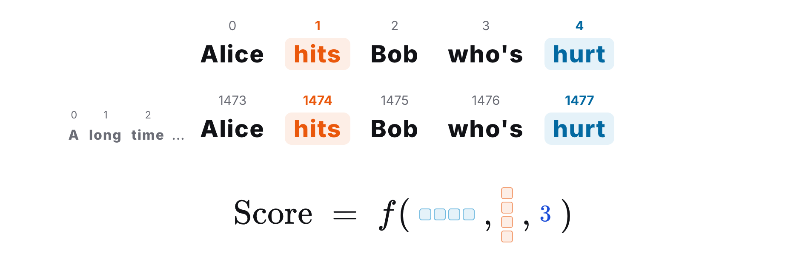

In other words, the attention score should depend on the two tokens' embeddings and on the relative position between them, and not on their absolute positions.

## How sinusoidal encoding represents relative position

Since relative position is what we care about, let's see how sinusoidal encoding behaves across an offset. Recall from the last post that each sin/cos pair in the encoding can be read as a hand on a clock. Every time \(pos\) goes up by 1, the hand turns counterclockwise by an angle of \(\omega_i\).

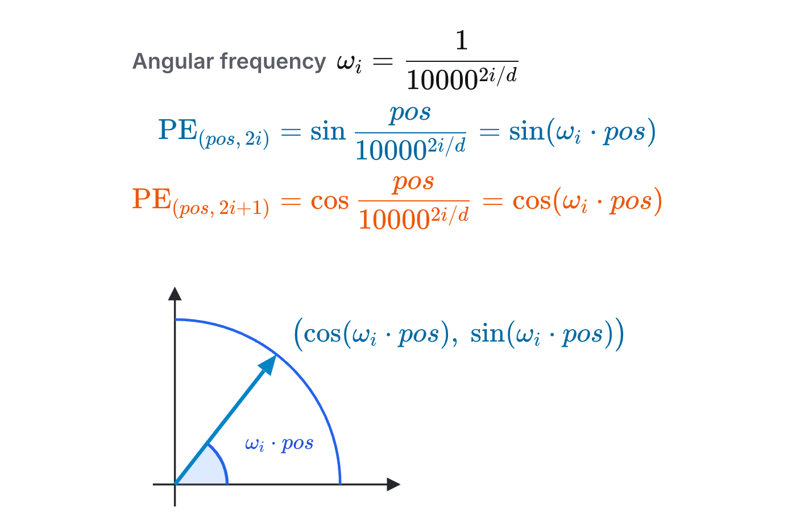

Now suppose we're handed one encoding but not the position it came from. Can we work out the encoding \(k\) positions later? In clock terms: we know which way the hand points, we turn it counterclockwise by \(k\) steps of \(\omega_i\), and we want to know where it ends up.

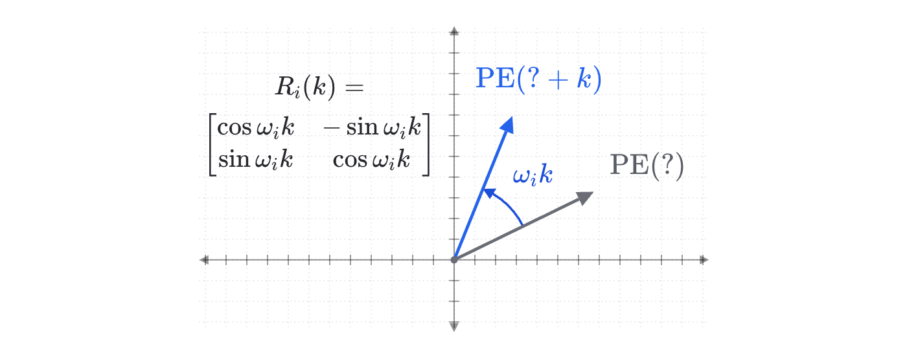

Here's how to solve it. Call the unknown position \(pos\), so what we want is the encoding at \(pos + k\). Write it out as a vector using the definition, with \(pos + k\) as the argument, and expand the sine and cosine with the angle-addition identities. (I'll skip the trigonometry itself; any high-school textbook has it.) The result factors neatly into a matrix times a vector. The vector on the right is the encoding we already have. The matrix on the left depends only on the offset \(k\), and \(pos\) appears nowhere in it. So given any encoding, multiplying it by this matrix gives the encoding at any offset from it, without knowing where it started. In clock terms this operation is a counterclockwise turn by \(k\) steps, so what we've done is derive the rotation matrix \(R_i(k)\) by calculation.

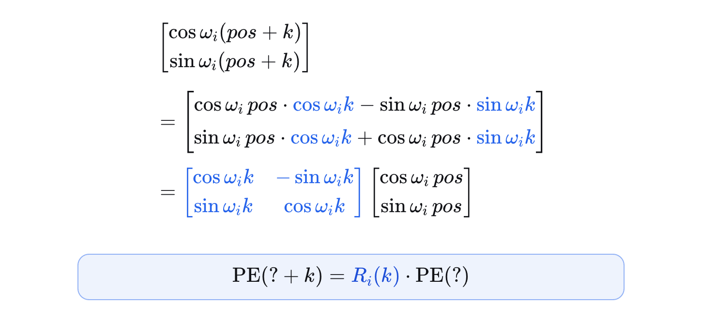

We can also ask the reverse question: given two encodings, how far apart are their positions? In clock terms, that's asking for the angle between two hands, and angles are what the dot product measures. The dot product of two vectors is the product of their lengths times the cosine of the angle between them.

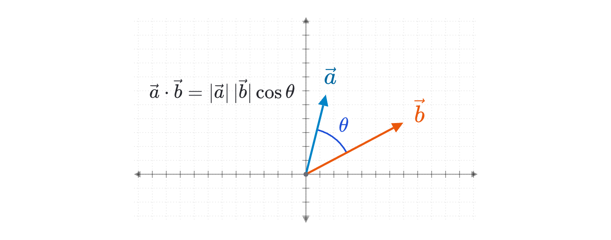

Every pair of the encoding lies on the unit circle and has length 1, so the dot product of two hands is the cosine of the angle between them. We can check this against the definition. Take two positions, \(pos_1\) and \(pos_2\), write their encodings as vectors and take the dot product. One more application of the cosine identity turns the result into \(\cos(\omega_i(pos_1 - pos_2))\). Both absolute positions have disappeared, and only their difference is left. We don't need to know either position: a single dot product gives us the relative position.

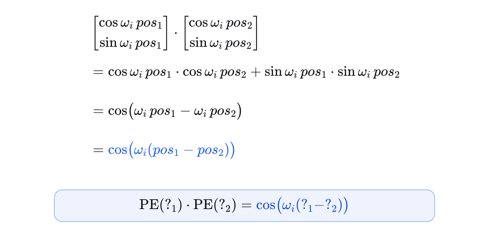

(Both derivations are for a single pair. A full encoding is \(d/2\) of these pairs stacked together, so the dot product of two full encodings is the sum over \(i\) of \(\cos(\omega_i(pos_1 - pos_2))\).)

So computationally, sinusoidal encoding has some very nice properties. How two encodings relate to each other doesn't depend on absolute position, and you can get from one encoding to the next by multiplying by a rotation matrix. That rotation matrix matters a great deal. It's the heart of RoPE, and we'll be using it again shortly.

## Where it breaks in the real dot product

Here's the catch. What attention actually multiplies together isn't the positional encodings. It's the query and key vectors, and \(q\) and \(k\) come from adding the positional encoding to the embedding and then multiplying by the projection matrices \(W_Q\) and \(W_K\).

Say the two tokens sit at absolute positions \(m\) and \(n\). In matrix form, their dot product is \(q_m\) transposed times \(k_n\). Substitute the definitions of \(q_m\) and \(k_n\) and expand. First, deal with the outermost transpose. The transpose of a product is the product of the transposes in reverse order, so \(W_Q\) transposed moves to the right, next to \(W_K\). Neither projection matrix depends on position, so we merge the two into a single matrix, \(W\). Next comes the transpose outside the left-hand parentheses. The transpose of a sum is the sum of the transposes, so it distributes over \(x_m\) and \(\mathrm{PE}(m)\). Finally, multiply out the two sums to get four terms.

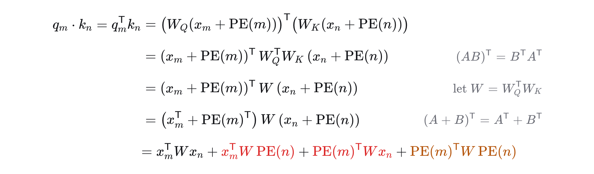

The first term, \(x_m^{\top} W x_n\), pairs the two token embeddings with each other. It depends only on meaning, which is exactly what we want.

The two middle terms each multiply an embedding by \(W\) and by a positional encoding. They carry absolute position straight into the attention score, which is exactly the interference we don't want. These terms exist because sinusoidal encoding is added: expanding a sum inevitably produces them, and there's no way around it.

Now look at the fourth term, \(\mathrm{PE}(m)^{\top} W\, \mathrm{PE}(n)\). It should remind you of what we just showed: the dot product of two encodings is the cosine of their relative position. The difference is the \(W\) sitting in the middle. That identity only survives if \(W\) leaves the encodings untouched, the way the identity matrix would, and a learned projection has no reason to be anything like that. So this term could have depended on relative position alone, but the projection matrix gets in the way. The reason is that sinusoidal encoding is added before the projection, so the projection matrix inevitably acts on the positional encoding too and distorts the role it plays in the attention score.

## RoPE: rotate instead of add

That pins down the root of the problem. Sinusoidal encoding is added, and it's added before the projection. RoPE changes exactly those two things. First, it multiplies instead of adding. Second, it's applied after the projection instead of before.

Concretely, take a \(d\)-dimensional input vector \(x\) for the token at position \(pos\). RoPE splits its elements into consecutive pairs, \(d/2\) pairs in all. The encoding is now the rotation matrix we met earlier: each pair is treated as a vector in the plane and multiplied by a rotation matrix, and pair \(i\) is rotated by the angle \(\omega_i \cdot pos\). I haven't said which vector the input is, because the same operation is applied to both \(q\) and \(k\).

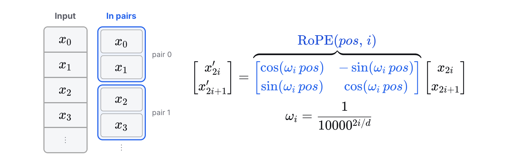

(The matrix shown is the block for pair \(i\). The full RoPE matrix is block-diagonal, with \(d/2\) of these \(2 \times 2\) blocks along the diagonal.)

The clock picture makes this intuitive. At first, \(q\) and \(k\) have just come out of the projection of \(x\) and carry no position information. Again, let their absolute positions be \(m\) and \(n\). First \(q\) is rotated counterclockwise by \(m\omega_i\) and becomes \(q'_m\). Then \(k\) is rotated by \(n\omega_i\) and becomes \(k'_n\). Now \(q'\) and \(k'\) each carry their own position, \(m\) and \(n\).

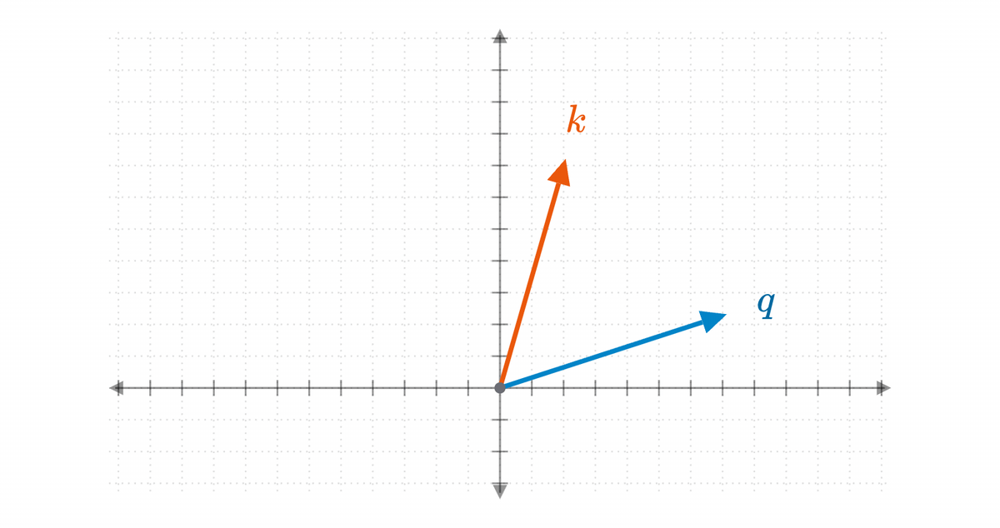

## Putting RoPE into the dot product

What happens when the rotation goes into the dot product? This time \(q\) and \(k\) are defined differently. The embedding is multiplied by \(W_Q\) and \(W_K\) first, and only once \(q\) and \(k\) exist does the rotation matrix multiply them. So the rotation sits on the outside.

Substitute these two definitions into \((q'_m)^{\top} k'_n\). Again, start with the outermost transpose. The transpose of a product is the product of the transposes in reverse order, so \(\mathrm{RoPE}(m)\) transposed lands in the middle, right next to \(\mathrm{RoPE}(n)\). Notice that this time there's no plus sign inside the parentheses, so there's nothing left to split. The expression stays a single term from start to finish.

So what do the two RoPE matrices in the middle multiply out to? Go back to the definition from the previous section. Transposing the rotation matrix swaps its two sine entries, the top-right and the bottom-left, and the only effect is that their signs trade places. Cosine is even and sine is odd, so plugging \(-pos\) into the definition gives exactly the same matrix. In other words, \(\mathrm{RoPE}(m)^{\top} = \mathrm{RoPE}(-m)\), which is easy to verify on paper. And \(\mathrm{RoPE}(-m)\) times \(\mathrm{RoPE}(n)\) is \(\mathrm{RoPE}(n - m)\): turn counterclockwise by \(n\) steps, then turn back by \(m\), and the net effect is a counterclockwise turn of \(n - m\) steps. Finally, write the projected vectors \(W_Q x_m\) and \(W_K x_n\) as \(q\) and \(k\), and the result is as compact as it gets.

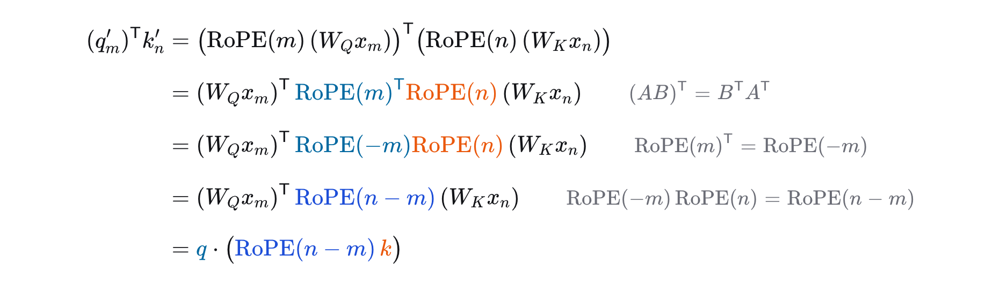

How should we read the result? We set out to compute the dot product of \(q'_m\) and \(k'_n\). A dot product is the product of the two lengths times the cosine of the angle between the vectors, so rotating both vectors by the same angle leaves the angle, and therefore the dot product, unchanged. Let's rotate both of them clockwise by \(m\) steps. That takes \(q'_m\) right back to \(q\). As for \(k'_n\), it was \(k\) turned counterclockwise by \(n\) steps, so turning it back by \(m\) leaves \(k\) turned counterclockwise by \(n - m\) steps.

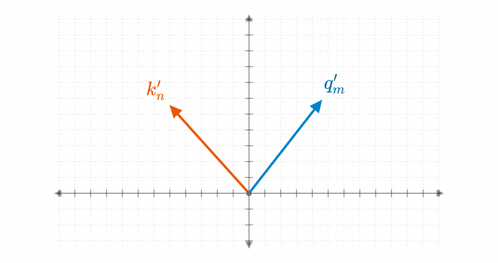

That's what the formula says: the dot product of \(q'_m\) and \(k'_n\) equals the dot product of \(q\) with \(k\) rotated counterclockwise by \(n - m\) steps. This is exactly the form we asked for at the start. It involves only \(q\), \(k\) and their relative position \(n - m\), which is a very clean result.

## Side by side

To wrap up, let's line the two encodings up against each other.

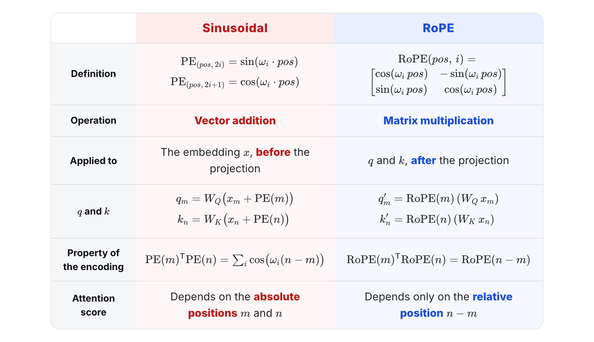

## References

1. Jianlin Su. [“Transformer升级之路：2、博采众长的旋转式位置编码”](https://spaces.ac.cn/archives/8265) (“The Road to Upgrading Transformers, Part 2: Rotary Position Embedding, the Best of Both Worlds”, in Chinese). 2021.
2. Jianlin Su et al. [“RoFormer: Enhanced Transformer with Rotary Position Embedding.”](https://arxiv.org/abs/2104.09864) 2021.
